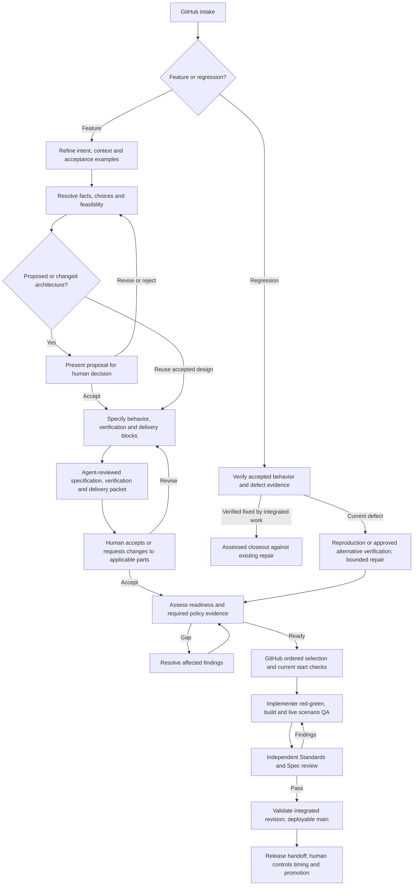

<!-- source: https://github.com/sidkik/planning @ dc76ca4c3e5b163d88b92524ccfa18d7e4d101d2 .claude/skills/sdlc-process/SKILL.md sha256:b220392a9ea2273a43456d481126a28965cc47e7b65815b0bfe2c0681cbcf6eb -->

> Source precedence: apply the [source adapter contract](#apply-packaged-sources-in-the-working-repository) at the end of this skill for working-repository ownership and source precedence.

# Follow the work

First, load [orchestrator](../orchestrator/SKILL.md) before selecting the route or investigating the work and its evidence. **Loading a skill requires a successful native skill invocation whose result delivers its full governing instructions and the concrete content of every reference it makes mandatory for the current action.** The delivered content needs no separate `Read` of a packaged source. In Claude, use the `Skill` tool with the available qualified skill name. For a delegated Codex worker the native mechanism is Codex's structured skill input (`{type:"skill", name, path}`; crew: `crew-codex task --skill <name>`). Claude evidence is the `Skill` call and the instructions it returned; Codex evidence is the accepted structured input and its result, never a file read. The request must resolve to exactly one enabled skill at the worker cwd, and a plugin-qualified request keeps that qualified identity through resume and redirect; a missing, disabled or ambiguous skill holds the dependent launch. Launch or discovery alone is not success: the worker's return or transcript must show the native invocation and that its result delivered the instructions. A result that only points to a packaged source, file or reference for the reader to open (the older pointer-only distributions) is an incomplete payload: record it as a scoped load gap, never as a successful load, including retrospectively for earlier sessions. Opening the pointed source is source inspection and does not complete the load. A mandatory supporting rule is loaded only when its content is delivered by the invocation; a link to it does not load it, and a separate sibling skill needs its own native invocation. Facts about the live project, such as tracker configuration, issue state, ownership and repository documents, are discovered from their owners when the action needs them and are not part of what a skill must deliver. Discovery, grep, `Read`, `cat`, and opening `SKILL.md` are source inspection, not invocation. Record the actual invocation result; a requested or failed call is not a successful load. If native invocation is unavailable or restricted (including a host without that tool), report the exact capability gap and the inspected sources separately. Source inspection can support independent authorized work, but cannot satisfy a required load or justify a readiness claim; hold only the dependent action. Completion: required invocation and delivered-content evidence are established, or the unmet load and its dependent action are explicit. Loading this dependency does not require spawning agents.

At continuation, a task pivot or dispatch, verify each applicable skill's loaded qualified identity, resolved path and source revision/digest against the required source or installed release under the repository's source-precedence rules. Keep the invocation evidence and comparison in the existing continuity/work record. A plugin installation update alone does not reload a skill in the current session. Reuse an earlier successful invocation while its delivered content remains in context and the applicable bytes remain unchanged and compatible; a newer package version alone does not require reload or restart. After actual loss or truncation of that content (for example compaction, a summary that dropped it, or a resumed session without it), natively load it again before dependent work; no retention beyond the context's limits is assumed. When relevant governing instructions changed, natively load the applicable revision, which must deliver its instructions, before dependent work. If that revision cannot be natively loaded, report the required identity/path/revision, the actually loaded identity/path/revision and the exact capability or resolution gap. Preserve existing work and scoped human authority, hold only actions needing the changed instructions, and carry them to a fresh capable session or authorized worker with the existing continuity record. Source reads cannot substitute for that load. Completion: each applicable load is verified or its exact gap and dependent hold are explicit.

This skill connects the existing Pocock activities to the [canonical process](#bundled-docs-work-agent-orchestration-process-orchestration-process-md). It is the session entry procedure, not another planning methodology. Consult the [tracker configuration](#bundled-docs-agents-issue-tracker-md) and the process sections relevant to the current action. Reuse established context and unchanged sources; a new user turn does not restart session preparation or require rereading the entire process. For a read-only request to find the next work item, apply tracker ordering, ownership and availability checks, then report the candidate and evidence limits. Readiness/start and repair requirements become applicable when proposing or performing those actions; selecting an item alone neither requires those checks nor authorizes implementation.

For recorded issue route/stage changes, stage finishes and read-only next-work
requests, apply the canonical [repository board delegation](#repository-board-delegation).
Resolve configuration in the delivery repository; the configured skill owns board
facts and actions. Its absence does nothing; an unavailable invocation is a scoped
board gap while authorized work continues.

## Required execution

Following the applicable process is mandatory. Establish the [route-specific stage checklist](#required-stage-completion) and required skill load/application results before the governed work. The entry dependency above establishes `orchestrator` before route selection or evidence investigation. Retain every required criterion, including missing evidence; phase prose and skill names cannot mark a stage complete. Update the existing work record and any status projection from criterion results, with their source revisions and assurance.

Recover omitted authorized work. If a required criterion cannot be satisfied, pause its dependent action and explain the exact blocker and needed human resolution; continue independent authorized work. Apply the canonical correction/reassessment rule before another recommendation. Ask one prerequisite-ready question at a time under the Sidkik interview adaptation; investigate technical facts yourself. Reuse accepted decisions and batch coherent changes under the [convergence rules](#converge-reviews-decisions-and-publication); ask again only on materially new evidence.

## Establish the current task

1. Read the user's desired outcome, scope and supplied sources. Locate matching work in GitHub and the owning document index before creating records. A new description need not include an issue. Discover its repository/initiative from evidence; ask only if ownership is materially ambiguous. Keep investigation moving while that answer is pending. The process's original initiative examples do not assign unrelated work to Core or its decision map.
   Starting in Core or another delivery repository is valid. Before writing a planning document, natively load [work-artifacts](../work-artifacts/SKILL.md) under the entry loading contract and read its linked [planning storage/publication convention](#bundled-docs-work-agent-orchestration-process-planning-repository-process-md). Establish the artifact's repository and appropriate isolated checkout through that skill even for single-repository work; cwd and existing delivery files are not placement precedent. Keep code-context work independent while any planning-checkout/publication gap is held.
2. Read the actual current issue history, candidate documents and relevant decisions, following named pointers in full. Distinguish accepted intent/design, new suggestions, current implementation and observations. Pin relevant source identities, revisions/digests, standing and gaps in the existing work record. Use OpenViking for discovery when available; retrieve canonical sources before relying on a claim. An absent context service does not prevent direct source reading.
3. Establish whether this is new work, an active continuation or a reviewed return. Check accountable ownership and existing claims. Use the [continuity procedure](#bundled-docs-agents-sdlc-records-md) before taking writing ownership from another session. A fresh session cannot claim a shared branch merely by finding it.
4. Name the current phase, its unresolved question and smallest authorized next action. Reuse the user's existing authorization and applicable scoped human decisions. Draft documents can support discussion, proposal writing and expressly authorized bounded work; their draft label does not erase those decisions. Record unknown authority as unknown for the affected action. Marking the whole process accepted requires its separate revision-bound adoption receipt.
   Distinguish authority to build the scoped behavior, approval to publish the specific ticket/packet, and readiness/start evidence. Trace each to its actual decision or criterion in the existing record. A missing publication approval or readiness result does not erase established build authority; build authority alone supplies neither publication approval nor readiness. Ask only for a genuinely unresolved scoped human choice.

Completion: the session can explain what this work is, which sources govern it, what remains unresolved and what action is currently justified. Do the resulting work; do not stop at presenting a route.

## Compose Pocock from the actual situation

Use [ask-matt](../ask-matt/SKILL.md) for source inspection when needed to identify the applicable flow; inspecting a router is not executing the selected flow. Sidkik's installed workflow skills are model-invocable, so the user's ordinary request is enough: **load the selected flow yourself** with its qualified installed name (for triage on Core #546, `sdlc-process:triage` with the issue URL) under the entry loading contract, then perform it within the user's authorization and the flow's own human decisions. Do not ask the user to type a slash command, and do not read-and-follow a skill as a substitute for invocation. Loading a flow supplies its instructions only; it grants no authority, answers no human decision and permits no external write the user has not authorized. If the native tool reports that only the user can invoke a skill (a third-party or host restriction), report that exact gap with the copyable slash command using the installed qualified name and current work reference, wait for the user's invocation, hold only the dependent flow and keep the selected issue and decisions for resuming. If no valid invocation is exposed, state the missing capability rather than inventing a slash command. Completion: the selected flow has actual invocation evidence, or the exact restriction or capability gap is reported and the dependent action held.

| Situation | Load and perform | Completion boundary |
| --- | --- | --- |
| Raw incoming issue | [triage](../triage/SKILL.md) and its brief | Verified intake disposition and next recipient; complete [workspace cleanup](#finish-triage-and-clean-up-the-workspace) when triage finishes. Synthesized delivery children need no repeat triage. |
| Bounded repo-backed idea | [grill-with-docs](../grill-with-docs/SKILL.md), [grilling](../grilling/SKILL.md), [domain-modeling](../domain-modeling/SKILL.md) | Resolve prerequisite-ready choices with the human and preserve the agreed vocabulary/decisions. Research facts yourself or through a bounded helper. |
| Uncertainty exceeds a session | [wayfinder](../wayfinder/SKILL.md) and its dependencies | Chart a destination and native tracker decision map, or resolve the next claimed frontier decision. Preserve chart/resolve separation and its one non-research decision per session limit. Hand a clear map to synthesis. |
| A missing fact or design observation | [research](../research/SKILL.md) or [prototype](../prototype/SKILL.md) | Retain evidence that answers the named question. A reliability experiment uses the process's technical-spike contract and actual dependency; prototype polish rules do not establish production fitness. |
| Reported broken behavior | [triage](../triage/SKILL.md), then [diagnosing-bugs](../diagnosing-bugs/SKILL.md) only for a named unresolved diagnostic gap | Apply the process's [bug-intake contract](#bug-intake-establish-the-defect-then-preserve-redgreen): verify current behavior and related integrated fixes first. A supported already-fixed disposition goes to authorized closeout. Use [VE-BUG1–3 and RS-BUG1](#reproduction-complete-and-ready-for-repair) to distinguish reproduction complete from ready for repair. Once reproduction completes, carry it forward; further minimization or ranked hypotheses are not prerequisites. A routine bug needs no feature map; specific alternative verification retains its own approval requirement. |
| Resolved intent/design | [to-spec](../to-spec/SKILL.md), then [to-tickets](../to-tickets/SKILL.md) when decomposition is needed | Synthesize criteria and public verification seams; prepare safe vertical delivery slices with genuine blocking edges. Present the agent-reviewed combined preparation packet for the human's decision on exact parts/revisions. |
| Authorized delivery assignment | [implement](../implement/SKILL.md), [tdd](../tdd/SKILL.md), delivery-repository specialist instructions | After readiness and start checks, implement at agreed seams; produce applicable build, red/green or alternative-verification and live QA evidence. Live QA on a local runtime environment follows the [local environment rules](#local-runtime-environments-select-own-validate-and-clean-up). |
| Completed implementation seeking review | [code-review](../code-review/SKILL.md) and the [orchestrator review contract](../orchestrator/SKILL.md#reviews--mandatory-skill-grounded-code-reading) | Independent Standards and Spec findings against the fixed base, exact diff and criteria/evidence, with reviewer-owned proof where feasible. Missing implementer QA returns to its owner before this gate. |
| Session/harness/directory boundary | [handoff](../handoff/SKILL.md), [phase-boundary guidance](#bundled-agents-skills-ask-matt-phase-boundaries-md), [continuity procedure](#bundled-docs-agents-sdlc-records-md) | Exact offered bytes and explicit receiving acknowledgment, with unanswered questions, writing ownership and [local environment custody](#retain-local-environment-custody) retained. |

The [Sidkik adaptations](#invocation-evidence-and-sidkik-adaptations) govern generic publication, integration-branch and automatic ready-label defaults. Documents and handoffs use work-artifacts, with substantial human review in a document PR; issue comments hold concise decisions and receipts. Configured GitHub operations replace local/beads fallbacks. Vertical slicing covers the actual accepted repository scope, including frontend only where that scope requires it.

## Advance with evidence

Before an actual advancement, use the [checkpoint boundaries](#policy-agent-checkpoints-across-the-process) to name the proposed action and obtain an independent [sdlc-policy-review](../sdlc-policy-review/SKILL.md) assessment. An ordinary question, agreement receipt, progress/blocker report or authorized correction within the current step is not a new checkpoint. A decision resolving a policy hold or changing an applicable control requires affected reassessment before dependent work. Apply the already-loaded [orchestrator](../orchestrator/SKILL.md), including its dispatch refresh rule, and use the [reviewer definition](../../agents/sdlc-policy-reviewer.md) as its brief. Supply underlying history and exact artifacts, not just your account of compliance. Reading sources and performing already-authorized refinement or corrective work within the present step do not each create a new process transition.

Apply the process's [stage and projection boundaries](#required-stage-completion) when continuing from triage or updating the widget, and its [bug-intake scope](#bug-intake-establish-the-defect-then-preserve-redgreen) when delegating reproduction work. These distinguish investigation, status bookkeeping and actual repair execution.

Record the assessment and disposition before acting. A missing reviewer or required evidence holds the affected transition; record the unavailable capability and continue independent authorized work. Reuse a prior assessment for unchanged applicable inputs and actions it explicitly covers, with a stated basis. A bounded readiness/start or publication/integration sequence can share one assessment under the checkpoint contract; verify its outstanding conditions before each action. A reviewer cannot assess its own assessment recursively or authorize human choices. Record the accountable session's actual action and resulting state; a pass alone is not proof the action occurred.

When a checkpoint was missed, retain that omission in history and assess the next affected advancement against the actual work, current evidence and prior scoped human decisions. Preserve completed work and unchanged build authority while correcting missing evidence or briefs within the authorized step. A later assessment cannot retroactively mark the missed checkpoint passed. Name the affected hold and resume condition; obtain affected reassessment before advancing, without requesting repeated blanket build approval. A new human decision is needed only for an unresolved authority choice, changed scope/architecture or permitted exception that actually requires it.

Use the canonical [readiness and start rules](#readiness-and-start-rules): assess each required contract control, then separately check native order, completed blockers, current authorization and actual allocated resources. At every new selection reconsider higher work and record unavailable-item skip reasons. Reordering changes future selections only; it leaves in-flight work, including waits, intact.

For proposed or changed architecture, present a concrete proposal with alternatives, impacts and evidence for the human's revision-bound decision. Internal implementation choices remain within delegated scope. A completed preparation packet or agent endorsement supplies neither architecture approval nor permission to start.

## Continue through changes and completion

Apply [change handling](#revisions-and-refinement-during-work) when a source, answer or implementation changes: identify affected criteria/consumers, preserve prior evidence and pause dependent work only. Routine failures and rebasing the implementation branch onto current main are implementer repair work within accepted scope; main wins. Fundamental architecture, behavior or outside-scope changes require the revised human decision. Correct findings and repeat affected policy/QA checks before continuation.

Follow the [reporting contract](#human-decision-requests-and-accountable-reports) through the [shared record procedure](#bundled-docs-agents-sdlc-records-md). Consolidate helpers into the accountable session's return. Complete delivery only when reviewed and validated integrated main is deployable with the required evidence/dispositions. Complete [closeout](#close-out-delivered-work), including [workspace cleanup](#finish-triage-and-clean-up-the-workspace) and any owned local environment, in the same authorized delivery sequence and prepare its release handoff; the human controls release timing/promotion. An agent exit, merge, deployment request or green unit suite alone does not establish that completion.

## Bundled required dependencies

The instructions above require the following pinned files. They are included here so this invocation loads them; separately invoked skills are not.

<a id="bundled-agents-skills-ask-matt-phase-boundaries-md"></a>
<!-- source: https://github.com/sidkik/planning @ dc76ca4c3e5b163d88b92524ccfa18d7e4d101d2 .agents/skills/ask-matt/PHASE-BOUNDARIES.md sha256:a8aa20158609ef39e2b308b6ba0660c91066838d07a867202e63a7744a88a3ed -->

### Phase boundaries

A **phase** is a chunk of work inside a session: the grilling, the implementation, the QA. The definition is fuzzy on purpose: a phase ends when you think *"ok, we're done with that"*.

The **phase boundary** is the gap between two phases, and it is the only place this decision belongs. Mid-phase there is no decision to make: continue, or split the work that's left into subagents. Compacting mid-phase makes the agent lose the thread.

#### The five options

| Option       | What it does                                                    |
| ------------ | --------------------------------------------------------------- |
| **Continue** | Stay in the session. No context switch at all.                    |
| **`/clear`** | Empty the context window and start from nothing.                  |
| **`/handoff`** | Write a portable markdown file and seed a session anywhere with it. |
| **Subagent** | Send the task to its own context window and get a report back.     |
| **`/compact`** | Compress this context and seed a fresh session with the summary.  |

#### The tree

Work top to bottom at the boundary. The first **yes** wins.

**1. Can you continue in this session?** Two things make the answer yes: the next phase needs this phase as a **primary source**, or you have enough [smart zone](https://www.aihero.dev/ai-coding-dictionary/smart-zone) left (~150k tokens) for the next phase to fit. Grilling → implementation is the standard yes: the implementation wants the reasoning verbatim, not a summary of it. Continue costs nothing and loses nothing, so rule it out before anything else.

**2. Is the context irrelevant to what comes next?** Is everything in this session (the exploration, the decisions, the dead ends) disposable? If so, **`/clear`**. It is the cheapest move on the board: it takes no time and hands back the whole window. `/clear` also isn't terminal: the old session stays resumable.

The cost of getting this wrong is one-way. Clear a *relevant* context and you lose the **why** behind what you built, and no amount of reading the diff back gets it returned.

**3. Do you need to hand off?** `/handoff` is narrow. You need it only when you are:

- swapping to a **new harness** (Claude → Codex),
- moving to a **new directory** or repo,
- sending the work to a **colleague**,
- or forking a side task you found **mid-phase** without derailing what you're doing.

That list is the whole clause. What `/handoff` buys is **portability**: a file that travels. If nothing is travelling, you don't need it.

**4. Can the task be done AFK?** Is it scoped tightly enough to run with you away from the keyboard, no steering? Then send it to a **subagent** and leave this session untouched. Automated review is the standard case: the agent reads the diff and reports, and you aren't needed while it does.

**5. Otherwise, `/compact`.** Relevant context, same harness, same directory, and you need to stay in the loop: this is where the tree lands, and it lands here often. Pass it an instruction (`/compact we're going to QA this area`) so the summary keeps what the next phase needs.

`/compact` is the **default, not the first reach**. It sits at the bottom because the four questions above it are all cheaper or more precise. The failure mode when people start here is a fresh session that is confidently wrong about a decision the summary flattened.

#### Primary and secondary sources

Every move except **Continue** turns a **primary source** into a **secondary source**: the session as it happened, replaced by a summary of it. The trade is always the same shape:

| Source                            | Information | Noise | Room to move |
| --------------------------------- | ----------- | ----- | ------------ |
| Primary (Continue)                | Full        | Lots  | Little       |
| Secondary (`/compact`, `/handoff`) | Lossy       | Less  | Lots         |

This is why question 1 comes first. You only pay the lossiness when staying costs more than it saves.

#### These are judgement calls

The questions are not objective: each has taste in it, and the same boundary can go two ways on two days. The value is in asking them **in order**, at the boundary rather than in the middle of the work.

<a id="bundled-docs-work-agent-orchestration-process-orchestration-process-md"></a>
<!-- source: https://github.com/sidkik/planning @ dc76ca4c3e5b163d88b92524ccfa18d7e4d101d2 docs/work/agent-orchestration/process/orchestration.process.md sha256:e5a0cdbffd1b9eef8d80f07da4104b9adffe3ceebb1f0f4e1c8565ec57afbff6 -->

### Sidkik orchestration process

Current operating-process draft, reconciled 2026-09-10 with the user’s recorded decisions. The [canonical map](https://github.com/sidkik/core/issues/507) indexes their owning receipts. This revision incorporates settled direction but does not adopt the whole process, select production architecture or establish runtime enforcement. The [historical snapshot — source locator](https://github.com/sidkik/planning/blob/dc76ca4c3e5b163d88b92524ccfa18d7e4d101d2/docs/work/agent-orchestration/items/core-gh-517-document-organization/source-navigation.research.md#source-08ca39189ec6) and its exact source asset preserve the previously reviewed input; earlier trials and reviews do not automatically validate this revision.

The [work-artifacts skill](../work-artifacts/SKILL.md) owns document types, container hierarchy and metadata. The [governed-context proposal](https://github.com/sidkik/planning/blob/dc76ca4c3e5b163d88b92524ccfa18d7e4d101d2/docs/work/agent-orchestration/workstreams/context/governed-context.spec.md) owns proposed retrieval and assessment behavior. This file owns the initiative's refinement, skill routing and readiness process.

Applicability: this shared procedure applies to the work identified by the current user and its owning repository. The September 6 reference journeys are Core-only: frontend mocks and Mux alignment belong to separate Web Platform work; Core acceptance uses its public contracts and scenario runner. Those example boundaries do not make Core the delivery repository for every new initiative. Resolve the actual scope and relevant repository standards before work; consumer impact still needs a disposition.


#### Combine the sources deliberately

Anthropic describes an artifact-driven loop: capture intent, apply organizational skills during specification, provide continuous implementation feedback, and independently verify completed work. Its example human gates and runtime choices are not automatically Sidkik policy. [AI-native SDLC playbook](https://claude.com/blog/the-ai-native-sdlc-playbook)

The installed [ask-matt router](../ask-matt/SKILL.md) defines the composition: repo-backed refinement uses grill-with-docs (grilling + domain-modeling); incoming work enters through triage; large multi-session uncertainty uses wayfinder. Research/prototype/diagnosis answer particular questions, to-spec/to-tickets synthesize settled work, and implement drives TDD followed by code-review. The [skill mapping below](#select-the-skill-flow-from-the-actual-situation) includes context/handoff, design and core-specific skills, with their triggers and outputs. This is a Sidkik adaptation; inspecting these workflows does not mean their publishing or implementation actions have run.

#### The funnel and its loop



Required policy checkpoints apply before actual affected advancement, including during planning, using the [checkpoint boundaries](#policy-agent-checkpoints-across-the-process). Ordinary conversation and bookkeeping are not separate transitions; an explicitly scoped assessment can cover a coherent sequence while preserving its individual conditions. The [context mapping](#workflow-handoffs-producers-durable-records-and-recipients) names the producers, records and recipients. Feature preparation and regression preparation are distinct; neither diagram traversal nor publication establishes readiness.

These are evidence states, not required departments or separate agents. A small regression can traverse them in one session. A large feature needs a decision map and multiple independently integrable blocks. Draft acceptance examples early: they expose uncertainty before prose makes a proposal appear settled.

#### Required stage completion

Following the applicable process is mandatory. Establish the route and its required criteria before performing the governed activity; keep them in the existing work record, not a new checklist document. Select the stages below from the prescribed skill route and actual scope. Continuations retain completed criteria only after checking their evidence and source applicability. A short repair does not acquire feature architecture or decomposition work merely because those stages exist.

| Stage | Required exit criteria (stable IDs) |
| --- | --- |
| Intake | **IN-1:** work owner, outcome, scope, current history/decisions and source revisions identified. **IN-2:** applicable route and required skills enumerated with trigger, source revision, load evidence and expected application result. Load each before its governed activity; `sdlc-process` first loads available `orchestrator` before route selection or evidence investigation under its [entry dependency](SKILL.md), then loads the applicable route skills. Actual current-context load evidence may be reused; a missing capability holds only orchestration-dependent actions. **IN-3:** current authority, ownership and smallest authorized next action established. |
| Verify | **VE-1:** reported behavior and accepted expectation separated from cause hypotheses; relevant current sources and integrated fixes inspected. **VE-2:** each material factual claim has evidence, revision/environment and limits; bug occurrence, current behavior and reproducibility have separate dispositions under the bug-intake contract. **VE-3:** dependent recommendations/questions use verified prerequisites; required skill application is supported by actual outputs, including checked helper returns when delegated. |
| Refine | **RF-1:** material unknowns resolved or explicitly dispositioned with affected scope. **RF-2:** prerequisite-ready human choices have actual scoped answers; proposed/changed architecture has the required revision-bound decision before dependent execution. Reuse unchanged accepted decisions. **RF-3:** observable acceptance examples and established vocabulary support the next block. |
| Brief / specify | **BR-1:** the owning brief/spec identifies scope, criterion IDs, expected behavior, verification seams and source decisions. **BR-2:** required context, skills, consumer impacts, delivery ownership and genuine dependencies are covered for this block; decomposition only when needed. |
| Review / disposition | **RV-1:** applicable independent review and policy checkpoint findings bind the actual candidate, criteria and history; required findings resolved for advancement, otherwise the stage remains visibly held. **RV-2:** proposed classification/next recipient or preparation packet and applicable human decisions are recorded; publication, acceptance and readiness remain distinct. |
| Ready / start | **RS-1:** each numbered readiness control below has evidence and a disposition. **RS-2:** native ordering, completed blockers, current authorization and actual allocated resources separately permit the proposed start; skipped higher work has a reason. **RS-3:** applicable checkpoint covers the exact action and its outstanding conditions. |
| Deliver | **DE-1:** accepted criteria map to actual implementation and required red–green or approved alternative verification, build and applicable live QA at identified revisions. **DE-2:** independent Standards and Spec findings resolved against the candidate. **DE-3:** integrated main has required validation and deployability dispositions; release authority remains separate. |
| Closeout | **CL-1:** owning GitHub work, related planning work and remaining findings have accurate dispositions. **CL-2:** applicable workspace cleanup and release or receiving-session handoff completed under the shared record procedure, with retained work/ownership, including any local runtime environment, accounted for. |

Incoming triage uses Intake → Verify → Refine (when choices remain) → Brief (when handing work onward) → Review/disposition → Closeout. Already-fixed intake uses its supported disposition without manufacturing a repair brief. Feature preparation uses applicable Intake/Verify/Refine/Brief/Review stages; authorized implementation then uses Ready/start → Deliver → Closeout. A research or spike return uses its learning contract through Verify and Review/disposition rather than claiming delivery. These stage names organize existing obligations; they create neither a new execution state machine nor a policy checkpoint per question or status update.

Triage closeout completes the intake disposition and any applicable handoff or cleanup; it does not claim delivery or require abandoning a workspace needed for the same authorized repair. When the user has authorized that repair and the applicable readiness/start assessment passes, continue into Ready/start → Deliver without an artificial session stop or repeated permission request. An investigation-only assignment ends at its scoped disposition. Delivery closeout retains DE-1–3 and the delivery record obligations.

For a current bug using reproduced repair, Verify also includes **VE-BUG1**, **VE-BUG2** and **VE-BUG3** from the [reproduction contract](#reproduction-complete-and-ready-for-repair). A triage disposition claiming “ready for repair” includes **RS-BUG1** in Review/disposition; an implementation route includes it in Ready/start. RS-BUG1 applies to a repair-ready or start claim, not ordinary triage classification or a requested stop/handoff. These criteria remain visible with a reasoned applicability result; non-bug work marks them N/A. Already-fixed dispositions and specifically approved alternative-verification routes use their own evidence contracts rather than manufacturing red; they cannot claim “reproduction complete.”

A criterion result records its ID, applicability and reason, status, supporting source/evidence revision, and assurance (`reported` or independently reviewed with its assessment reference). Include route-required skill load and application results separately. Enumeration comes from the pinned route and triggered skill requirements, not whichever successes the agent elects to report. Missing checklist/template or omitted required results are unknown; they cannot disappear from completion accounting. Additional triggered requirements extend the checklist before the affected activity.

A stage is complete only when every applicable required criterion has sufficient current evidence and its required independent assessment. A justified inapplicable criterion remains visible as N/A, distinct from a pass. An authorized exception identifies its actual human authority, affected criterion/revision, conditions and alternative proof; display it as an exception, not successful performance of the waived requirement. The stage cannot receive an unqualified complete result while relying on an exception. Loading a skill, writing “verification done,” or reporting an overall green check does not complete its outputs. Manual evidence and independent agent review supply their stated assurance, not authenticated compliance.

Missing future work is pending, not a violation. Claiming completion or attempting dependent advancement with an unmet required criterion is a process violation. Recover omitted authorized work immediately and reassess affected results. If a required step cannot be satisfied, tell the human the exact criterion, blocker, dependent work held and resolution needed; ask for the necessary decision or capability instead of silently skipping or waiving it. Continue independent authorized work. Existing exceptions require the applicable authority and checkpoint; agent confidence cannot grant one.

Status projection is bookkeeping: selecting a route, changing the displayed stage or correcting widget fields creates no policy checkpoint. Display a pending Ready/start stage while its execution conditions remain held, with incomplete criteria and the actual hold visible. A route label cannot authorize execution or imply its criteria passed; repair a stale projection from the underlying evidence without replaying unchanged assessments.

When corrected, withdraw the affected unsupported claim and dependent questions/recommendations, identify which completed criteria relied on it, and return those results to unresolved until the underlying flow is verified. Changed relevant facts or source revisions likewise invalidate dependent completion; preserve prior evidence as historical. Repeating a revised guess is not recovery.

##### Repository board delegation

On a recorded issue route/stage change and when a stage finishes, read the
**delivery repository's** `docs/agents/issue-tracker.md`, even when the session
cwd is planning or tooling. Resolve that checkout from the owning issue and
actual delivery scope; cwd alone is not ownership evidence. Its optional YAML
frontmatter scalar `board_skill: <native-skill-name>` selects the repository's
board skill (unquoted, optionally plugin-qualified). Missing or empty selection
means no board action. Project identities, columns, priority views and all
route/stage-to-board mappings belong to that skill, never shared SDLC instructions.

The accountable agent natively loads the selected skill under the entry loading
contract and passes the recorded event unchanged:
`{event: "stage-change"|"stage-finish", issueUrl, route, stage, outcome}`.
Use the full owning issue URL; routes remain `triage`, `feature`, `delivery`,
`research`. Pass the recorded machine stage ID, not a renamed label. The current
status template uses `IN` Intake, `VE` Verify, `RF` Refine, `BR` Brief,
`RV` Review, `RS` Ready, `DE` Deliver and `CL` Closeout, with each route's
existing subset. Its Brief and Ready labels abbreviate this table's
Brief / specify and Ready / start; they do not introduce new stages. Stage-change
outcome is `null`; stage-finish outcome is the actual recorded disposition.
A newly recorded completion claim without an explicit outcome uses its reported
projection standing (`complete`, `not-applicable`, `held`, `exception`, `unknown`
or `pending`), never an inferred successful completion. Unchanged status creates
no event. Retain the latest finish disposition per stage in the existing status
state before emitting requests. Within the same issue, route and source/evidence
revision, repeating that outcome creates no second event, including after an
intervening status write. A changed outcome or revision, or re-entry into that
stage, permits a new finish. This bounded disposition is not an event history or
proof that native invocation succeeded. For an atomic finish/advance update,
emit stage-finish requests before the stage-change request, preserving causal
finish-before-entry order. The board skill owns mapping and moving the card.

For read-only “what is up next” or “check GitHub for next work,” read the same
delivery configuration and natively load its board skill with
`{event: "next-work", readOnly: true}` to obtain candidates. Retain tracker
ordering, ownership, blockers, claim checks and evidence limits; selection never
authorizes start. Without a board skill, use the existing tracker selection
procedure. An unavailable configured skill, inaccessible tracker or invocation
capability creates a visible **scoped board gap**, never a blocker of authorized
work. Candidate ordering that cannot be verified stays unknown.

With the status plugin, the accountable agent supplies the absolute delivery
checkout to `write`/`record` using `--delivery-repo`; subsequent same-work records
retain it. `record` accepts `finished: {stage, outcome}` for a stage's explicit
finish. Successful updates emit `SDLC_BOARD_DELEGATE` JSON requests in the tool
response; read-only `next-work --delivery-repo PATH` emits the candidate request.
The agent executes every emitted request through the native harness: Claude
`Skill` with the selected name and JSON event arguments; Codex structured skill
input with the resolved name/path and the unchanged event as task text, using
the available crew `task --skill` capability at the delivery checkout when needed.
Node emits requests only; it cannot perform a native invocation. Reading a skill
file, CLI emission or launching a job is not invocation success. Verify the native
result delivered the board skill's instructions, report board failures truthfully, and continue
authorized work. This is an instruction-driven hook, not a background dispatcher,
poller or delivery guarantee. If no status runtime is available, perform the same
delegation from the existing recorded event directly.

##### 1. Capture intent

Record the affected actor, current problem, desired observable outcome, reason to act, constraints and exclusions. Identify who can approve the intended behavior. Keep product intent separate from an initial technology suggestion.

Example: “An implementer can obtain a scoped decision while work remains active, and the decision remains available after coordinator restart.” Zulip is the intended human conversation surface; authenticated decision capture and coordinator continuation remain integration work, not a new chat-product selection.

Exit: an authorized person accepts the intended outcome and boundary, or the coordinator admits a qualifying regression within existing approved behavior. Bug reproduction alone does not establish the intended fix. Existing accepted intent should be reused rather than sent through approval again.

###### Bug intake: establish the defect, then preserve red–green

User requirements clarified 2026-09-06: verify that a reported bug is an actual defect, and use a focused failing reproduction/regression test wherever feasible. The submitter need not produce that test. Correlated GCP logs/traces can establish that the defect occurred; a repeatable test separately establishes that we can reproduce it. Record occurrence evidence and reproducibility as separate results rather than rejecting a credible report because the reporter cannot write a test.

Start from the symptom, expected behavior and whatever locating information is available: approximate time/timezone, environment, affected operation/request, tenant or entity. The intake/diagnosis agent gathers the missing technical evidence. Expected behavior must have an accepted basis; neither an ERROR log nor an arbitrary failing assertion establishes a product defect on its own.

Treat issue comments as evidence and clarifications of the reported behavior. An additional defect reported in a comment gets a separate linked intake or an explicit disposition requiring one, unless the authorized owner expressly expands this work's scope. Its unresolved questions do not block the original repair without a demonstrated dependency. Reuse existing related issues and decisions before asking a new product question.

Before expanding historical diagnosis or proposing a repair, inspect current `main`, related integrated fixes and existing regression checks. Perform bounded verification of the reported behavior on the current revision using the delivery repository's environment instructions; this is part of triage, not a separate permission boundary. Historical logs establish occurrence on their recorded revision, not a defect in today's code. A setup failure or an unrelated green test leaves current behavior unresolved.

Creating or delegating a focused reproduction test within authorized triage is investigation, including a test-only edit needed to demonstrate the reported symptom. It does not start the production repair or require that repair's readiness checkpoint. Name the helper's test/evidence scope, write fence and relevant environment constraints; load the governing skills and verify its return. Production behavior changes remain behind repair readiness/start. A transfer of accountable writing ownership still follows its own handoff contract.

When relevant integrated work explains the failure and current verification covers the accepted behavior, use an **already-fixed** disposition: link the delivered fix, tested revision, behavior checked and material limits, then follow authorized policy-assessed closeout as completed against that repair. Reuse sufficient existing checks. This route requires no new repair brief, manufactured failing test or alternative-verification exception for code that needs no change. Exact original-browser replay or historical-environment reconstruction is needed only when a material uncovered behavior makes it necessary; state that gap. A green check alone without a supported connection to the report is not proof of resolution.

If current behavior still fails, follow the diagnosis and repair route below. If coverage remains inconclusive, investigate the smallest unresolved difference. A nearby timeout or synthetic failure is a separate observation until evidence connects it to the reported defect; give independent findings their own disposition instead of making them prerequisites to resolving this report.

Establish the actual target using the delivery repository's environment instructions. When investigating shared-dev GCP telemetry, use the [GCP observability skill — source locator](https://github.com/sidkik/planning/blob/dc76ca4c3e5b163d88b92524ccfa18d7e4d101d2/docs/work/agent-orchestration/items/core-gh-517-document-organization/source-navigation.research.md#source-bd7a389db4ac) for the actual environment and query mechanics. It documents shared-dev telemetry in `ep-core-dev`, the OTEL collector log and the `deployment.environment.name` distinction. Core defines correlation vocabulary including `tenant.id` and `operation.id` in [telemetry semantic conventions — source locator](https://github.com/sidkik/planning/blob/dc76ca4c3e5b163d88b92524ccfa18d7e4d101d2/docs/work/agent-orchestration/items/core-gh-517-document-organization/source-navigation.research.md#source-dc0793592f4e). Inspect actual records before assuming these fields or a deployed revision are present. Authorization failures, sampling/retention, incomplete pagination or an unavailable exporter are evidence gaps, not proof that no defect occurred.

The existing issue/PR contains a concise evidence summary, linking retained proof as needed under the work-artifacts retention rule. It covers:

- Accepted expected behavior versus the observed violation, with explicit separation between observation and suspected cause.
- Environment/project, UTC event window, affected services and known deployment revision/image; mark missing provenance explicitly.
- Available trace/span, request, operation, workflow/run and affected entity identifiers; state which joins were verified rather than correlating solely by similar timestamps.
- Exact bounded queries, retrieval time, source log/trace identifiers and console links, plus retained relevant exports with content digests where permitted. Link-only evidence may expire or require access the reviewer lacks.
- Coverage/limitations, investigator attribution and a readable explanation of why the records support this specific claim. Preserve access controls; a third-party handoff uses an appropriately redacted extract, not copied credentials or unrestricted tenant data. A digest detects later alteration; it does not authenticate the original claim by itself.

If the evidence demonstrates a violation of accepted behavior, record a confirmed observation even when reproduction remains unavailable. If it only supports a hypothesis, keep the claim suspected/inconclusive and investigate. Confirmation of occurrence does not establish root cause, authorize broader behavior changes or grant implementation readiness automatically.

###### Reproduction complete and ready for repair

Choose a focused test or repeatable procedure at the relevant seam. **Reproduction complete** requires all three criteria:

| ID | Required evidence |
| --- | --- |
| VE-BUG1 | The asserted expected behavior links to an accepted requirement or an explicit human decision applicable to this work. |
| VE-BUG2 | The check ran against the affected code path and failed on the reported wrong behavior. Identify the failing observation and its connection to the report; setup, mock configuration and unrelated assertion failures do not satisfy this criterion. |
| VE-BUG3 | The implementer can retrieve the exact test/source and fixture or procedure, command, tested revision, environment and expected-versus-actual result. Retain these through the existing work/evidence mechanism; a disposable path that the next session cannot access does not satisfy this criterion. |

**RS-BUG1 — Ready for repair:** the proposed change restores the established behavior within current authorized scope, and the existing applicable [readiness and start controls](#readiness-and-start-rules) permit that action. An unresolved product or architecture decision holds only work that depends on its answer. A red test alone grants no implementation authority. “Reproduction complete” and “ready for repair” never mean “fixed.”

Once VE-BUG1–3 pass, stop reproduction work and carry the check into the next authorized repair action. Further minimization and ranked hypotheses are not prerequisites. Apply `diagnosing-bugs` only to a named unresolved diagnostic gap; mark its conditional load/application requirements N/A with the completed reproduction evidence when diagnosis was not needed. Preserve actual load/application results when diagnosis resolved an earlier gap. This is the Sidkik bounded-repair adaptation of the imported hard-bug workflow, not a per-case exception requiring a human waiver.

Before additional investigation, name the missing criterion or failed repair observation, the bounded next check and its stopping condition:

| Observed gap | Bounded next check and exit |
| --- | --- |
| Setup fails before the target path | Correct the identified setup failure and rerun the target check; exit when the target path executes, then assess VE-BUG2. |
| The red observes a different symptom | Correct the reproduction to exercise the reported behavior; exit when its failing observation establishes that connection. Disposition independent findings separately. |
| Intermittency prevents reliable reproduction | State the trial count or time limit and the required symptom-specific failure count before running. Report the actual observations against that threshold; reaching the limit without meeting it is inconclusive, not reproduction complete. |
| Expected behavior is unresolved | Ask for the specific prerequisite-ready behavior decision; hold only its dependent check/repair. |
| The bounded fix leaves the target check red | Investigate that failed repair observation with a named hypothesis and bounded check; exit when evidence resolves it or identifies the next specific gap. |

A vague request for more confidence, the presence of a conditional skill on a checklist, or a desire to complete every hard-bug phase is not a diagnostic gap. The deterministic case needs one valid symptom-specific red; repeat trials require the stated intermittency gap. A full end-to-end suite is not required merely to confirm a simple report.

The retained check travels with the bounded repair. The implementer reproduces red in the assigned workspace, makes the fix and turns the same check green without weakening its intended expectation. Do not invent a redundant second intake test. When telemetry supplied the initial confirmation, derive a controlled regression check from it before changing code where feasible. Extend coverage as needed, then perform the established full build, live scenario QA and independent review. Record occurrence and reproducibility separately; confirmed occurrence without a valid red follows the specific alternative-verification path below.

**Accepted user decision, 2026-09-06:** when evidence confirms the defect but bounded diagnosis cannot reliably reproduce it, a human may approve a specific alternative verification plan before the repair proceeds. This permits a reviewed exception; it does not delegate silent waiver authority to the architect or approve any particular repair. The plan records the occurrence evidence, attempted reproduction, cause hypothesis and uncertainty, bounded correction, checks that can disprove it, success/failure conditions and recovery. Include explicit exposure/time bounds when verification needs deployment. Approval binds the human, work item and exact plan revision. Implementer-owned QA and independent review remain required; report alternative verification accurately rather than claiming red–green. The overall process remains draft pending its remaining decisions and validation.

##### 2. Refine the next building block

Use grill-with-docs for a repo-backed idea whose refinement fits a session. Use wayfinder when unresolved decisions span sessions, with a declared destination and an actual tracker-backed map of decision tickets. The map's destination may be a spec, decision or other defined outcome; it must be stated rather than silently changed to implementation. Keep later in-scope uncertainty visible without detailing every future ticket. See the [wayfinder lifecycle](#wayfinders-exact-place-and-lifecycle) for claims, dependencies, resolution records and exit.

Use grilling/domain-modeling for actual choices and vocabulary. Look up facts instead of asking the user to remember them. Present only decisions whose prerequisites are understood. An architect may settle implementation choices already delegated within approved parent scope. A proposed or changed architecture must be presented for the human’s acceptance, rejection or requested revision, even when the parent intent is accepted. Reuse an unchanged accepted architecture. Changed intended behavior or outside obligations also go to the human; [the scope decision](https://github.com/sidkik/core/issues/514#issuecomment-5608339950) owns that boundary.

For each uncertainty record: the question, which decision it blocks, consequence if wrong, cheapest way to resolve it, owner, and evidence needed. Distinguish blocking unknowns from permitted implementation choices and deferred future work. Resolve high-impact prerequisites first.

Exit: the next block has observable acceptance examples and every material unknown has a disposition. Do not require the whole parent feature to be specified end to end.

##### 3. Buy evidence only when it changes a decision

| Work type | Question | Completion artifact |
| --- | --- | --- |
| Research | What do authoritative sources or existing code establish? | Cited findings, limitations and decision implications |
| Decision conversation | Which outcome or tradeoff do we authorize? | Recorded choice, rationale, scope and approving authority |
| Prototype | Does this interaction or state model match the intended experience? | Rough artifact, observed feedback and resolved design choice |
| Technical spike | Can this mechanism satisfy a named requirement under relevant conditions? | Reproducible experiment, measured result and recommendation |
| Implementation | Deliver this accepted behavior under these constraints | Integrated behavior, build/test/scenario evidence and independent review |

A spike is work, but its acceptance is learning. Size does not distinguish it: a large task with known behavior is implementation; a ten-line unknown authentication path may justify a spike. Routine code exploration or reversible implementation choices belong to the implementer, without a separate spike ticket.

The current `prototype` skill covers throwaway interaction/logic exploration and intentionally skips production polish and default tests. It is not a technical reliability proof. A technical spike must exercise the real dependency when its claim concerns real authentication, recovery, isolation or performance. No dedicated technical-spike skill is established by this proposal.

##### Technical spike contract

Before starting, record:

- The precise question and the decision its answer will enable.
- The hypothesis and an observable pass/fail/inconclusive rule, with numeric thresholds where relevant.
- The minimum realistic environment, dependency versions and experiment procedure.
- An agreed time/resource limit and allowed side effects.
- Evidence to retain, cleanup, and prototype-code disposition.

Stop when the evidence answers the question or the limit is reached. A failed hypothesis can be a successful spike. An inconclusive result records what prevented resolution and the smallest useful next experiment; it does not automatically justify extending the same open-ended exploration.

Preserve the evidence and feed the result into the spec: choose, reject, narrow scope or defer. Experimental code is not automatically production-ready. Any code retained for delivery passes the normal architecture, TDD, scenario and review requirements. Disposable experiments do not create a parent feature integration branch.


#### Document publication and decision ownership

GitHub remains intake, workflow and system of record. Each decision has one owning issue; the map holds a named pointer rather than a second editable decision. The [accepted planning-repository convention](#bundled-docs-work-agent-orchestration-process-planning-repository-process-md) owns `sidkik/planning`, stable `plan/<repo>-gh-<issue>/<description>-<change-id>` branches, isolated writer checkouts, exact-revision handoffs and explicit writer transfer. Implementation issues and code stay in their delivery repositories. Publication of a draft is distinct from human acceptance and readiness.

The user [subsequently authorized](https://github.com/sidkik/core/issues/517#issuecomment-5625609455) the planning repository now so the process can be reviewed as documents. The private repository exists and its six primary-owned draft records transferred under the [recorded cutover](https://github.com/sidkik/core/issues/517#issuecomment-5625801674). Other owners retain their unmigrated sources. The earlier [finish-plan-before-setup direction](https://github.com/sidkik/core/issues/507#issuecomment-5621037891) continues to constrain supporting-system infrastructure and implementation; its repository-creation restriction is superseded by that scoped user instruction. Managed work artifacts, including handoffs, use the existing work-artifacts hierarchy rather than temporary directories. OpenViking retrieves relevant context; exact sources, governing status, access and approvals establish applicability.

At each decision or meaningful return, record the result in its owning issue/document and update the map’s named pointer in the same reconciliation. A superseding decision updates the active owner and flags affected plans/handoffs; preserve prior evidence as history. Posting a comment or writing a file does not notify another hosted session or prove receipt. The accountable session consolidates its own helpers and reports upward; helpers are not independent global work owners.

#### Artifact map

Logical records can share one document; create only those needed to establish the work contract.

| Logical record | Required content and trigger | Creation/refinement method | Completion and authority |
| --- | --- | --- | --- |
| Intent and scope | Actor/problem, desired outcome, accepted behavioral baseline, constraints, exclusions and parent authority. Every admitted effort needs this; a regression may reference an existing accepted expectation. | Intake/triage; conversation and targeted grilling for ambiguous intent. | Human admission for changed intent/behavior or outside obligations. Coordinator may admit a qualifying reproducible regression or act within already delegated parent scope. Record the actual decision source. |
| Context manifest | Applicable architecture, terminology, contracts/consumers, skills, prior decisions, ongoing work and execution-resource requirements; source revisions, missing coverage and contradictions. Every next block needs the relevant subset. | Wayfinding and scoped context discovery; direct source checks for current work and runtime facts. | All governing sources are identified or a gap is explicitly resolved. A recent index timestamp is insufficient proof of freshness. This is evidence, not a new approval ceremony. |
| Decision/experiment record | A question, why its answer matters, affected block, alternatives, evidence and disposition. Create only when an uncertainty warrants it. A spike also declares its hypothesis, procedure, budget, measurement and learning outcome. | Research for facts; grilling for choices; prototype for interaction; real-dependency spike for feasibility. | Answer is supported or marked inconclusive with the dependent work still blocked. Promote enduring architecture decisions through the existing ADR process; keep local implementation choices local. |
| Behavior spec | User-visible result, identified acceptance criteria, failures/bounds, contracts/consumer impact, architecture decisions, public verification boundaries, exclusions and permitted implementation freedom. Every implementation block needs an applicable contract. | `to-spec` synthesis after refinement; architectural and acceptance review. | Resolves the accepted problem within parent scope. Expected outcomes have an independent basis; material choices and test boundaries have the required disposition. No blocker is concealed as an implementer assumption. |
| Delivery plan and child-work map | Next trunk-integrable blocks, real blocking edges, contract/migration sequence, activation/recovery behavior and verification approach. A child references its spec revision and criterion subset plus any child-specific criteria. | `to-tickets` for verifiable vertical blocks; implementer prepares the concrete execution plan against current code. | Each queued block has a safe intermediate result. The plan may share the work record. Detailed file paths belong in revision-specific execution notes, not the durable behavior spec. |
| Readiness and dispatch record | Assessed spec/context revisions, control results, unresolved findings, applicable approval/delegation reference, skills and expected invocation outputs, execution requirements and escalation route. | Structural checks, policy checks and semantic review; coordinator dispatch. | Readiness, dependency satisfaction, resource availability and authorization are separate results. A validated ready record alone does not start work. Bind a dispatch to the exact accepted inputs. |
| Implementation evidence | Criterion-to-proof mapping, red→green evidence where applicable, build results, live bounded happy/negative/boundary scenarios, tested code/spec/environment revisions, deviations and limitations. | Implementer uses TDD and relevant writer/Tilt/scenario skills, including helpers where useful. | Implementer completes full QA; failed or missing required evidence prevents review-ready status. Evidence describes actual tested outcomes, not proposed tests. |
| Review and release evidence | Independent standards/spec findings and their dispositions; integrated-revision checks, activation/deployment authorization and health/recovery observations when releasing. | Independent code/spec review, followed by the applicable delivery controls. | Review and deployment remain distinct. Historical passing results remain historical when dependencies change. The human controls release timing and promotion; exact release commands/role enforcement remain to specify, and this draft grants no production action. |

The reusable control definitions and source skills sit outside individual features. A work record references applicable revisions instead of copying organizational policy into every ticket. Artifact ownership denotes who maintains it; authority to approve or execute comes from the actual permission/delegation record.


#### Select the skill flow from the actual situation

The installed [ask-matt router](../ask-matt/SKILL.md) is the reference for how Pocock's skills compose. This table maps the relevant paths to their outputs; it does not require every skill on every item.

| Situation | Skill and dependency | Result / handoff |
| --- | --- | --- |
| Unsure which workflow applies | [ask-matt](../ask-matt/SKILL.md) | Select the main flow or the appropriate entry path from the problem's uncertainty, size and source. |
| An incoming issue needs evaluation | [triage](../triage/SKILL.md) | Read issue history, relevant code, existing implementation and prior rejections; classify, verify and refine as needed. Record disposition and a durable [agent brief](../triage/SKILL.md#bundled-agents-skills-triage-agent-brief-md). Use the configured category/state labels. Newly synthesized delivery tickets do not need redundant intake triage. |
| A repo-backed idea fits one refinement session | [grill-with-docs](../grill-with-docs/SKILL.md) → [grilling](../grilling/SKILL.md) + [domain-modeling](../domain-modeling/SKILL.md) | Ask one prerequisite-ready question at a time; investigate facts and obtain real answers to unresolved human decisions. Sharpen language against the glossary, record resolved terms and qualifying ADRs, and retain decisions for synthesis. |
| Important uncertainty spans sessions | [wayfinder](../wayfinder/SKILL.md), using grilling + domain-modeling and typed decision work | Maintain a tracker-backed decision map. Resolve the route to a declared destination, then hand linked decisions into spec synthesis. See the lifecycle below. |
| A decision lacks an external/source fact | [research](../research/SKILL.md) | A bounded background investigation returns cited findings and limitations. Research feeds the decision; it does not make a human choice or prove runtime behavior. |
| Logic/state or appearance needs an interactive answer | [prototype](../prototype/SKILL.md) | Follow its logic or UI branch, produce a runnable throwaway artifact, obtain feedback and retain the answer/source pointer. Production reliability requires a separate real-dependency experiment. |
| A named unresolved diagnostic gap needs investigation | [diagnosing-bugs](../diagnosing-bugs/SKILL.md) | Use the [bounded-repair adaptation](#reproduction-complete-and-ready-for-repair) first. Apply the hard-bug workflow to the named gap with a bounded check and exit; completed reproduction does not require additional minimization or ranked hypotheses. Scope admission and implementer QA/review still apply. |
| Module shape or test seam is uncertain | [codebase-design](../codebase-design/SKILL.md) plus applicable core architecture guidance | Use the shared module/interface/seam vocabulary to settle observable behavior and testability. This reference supplies design reasoning, not a separate mandatory interview stage. |
| Resolved intent/design needs a durable spec | [to-spec](../to-spec/SKILL.md) | Synthesize the conversation and codebase context; establish public test seams; produce problem, solution, stories, decisions, testing and scope sections. Its tracker publication is an action, distinct from drafting this process proposal. |
| A ready spec needs multiple delivery assignments | [to-tickets](../to-tickets/SKILL.md) | Draft verifiable vertical slices and genuine blocking edges, review the breakdown, then publish child work. A small settled task need not manufacture a multi-ticket plan. |
| A concrete assignment is ready for delivery | [implement](../implement/SKILL.md) → [tdd](../tdd/SKILL.md) → [code-review](../code-review/SKILL.md) | Implement at pre-agreed seams, one red→green slice at a time, run applicable validation and review before commit. The installed TDD puts refactoring in review rather than inside its red→green loop. Sidkik adds the established full live scenario QA obligation before independent review. |
| A completed change needs independent review | [code-review](../code-review/SKILL.md) | Pin the comparison base and spec; independent parallel Standards and Spec reviews produce separately reported findings. The actual reviewed diff and evidence revisions must match. |
| Work crosses a session/harness or directory | [handoff](../handoff/SKILL.md) and [phase-boundary guidance](#bundled-agents-skills-ask-matt-phase-boundaries-md) | Preserve relevant context, decisions and source pointers. The user’s work-artifacts convention overrides the skill’s temporary-path default: write the handoff in the owning work container, with exact source revisions, explicit recipient/writer-transfer scope and any [local environment custody](#retain-local-environment-custody) pointers. A handoff summary is not a replacement for canonical evidence. |
| SDLC entry; later delegation or agent-facing documents | [orchestrator](../orchestrator/SKILL.md) at entry; [writing-for-agents](../writing-for-agents/SKILL.md) when writing instructions | Follow the entry dependency before route/evidence investigation. Apply grounded dispatch and verified-return rules when delegation is warranted; loading does not require spawning. Write concise context pointers and checkable completion conditions when authoring instructions. |

Core-specific skills are selected by the actual work: [architecture-guideline — source locator](https://github.com/sidkik/planning/blob/dc76ca4c3e5b163d88b92524ccfa18d7e4d101d2/docs/work/agent-orchestration/items/core-gh-517-document-organization/source-navigation.research.md#source-07dc47b1b553) before service design, writing or review, the relevant transport/domain/storage/config/error/Temporal writer skills for implementation, [go-test-writer — source locator](https://github.com/sidkik/planning/blob/dc76ca4c3e5b163d88b92524ccfa18d7e4d101d2/docs/work/agent-orchestration/items/core-gh-517-document-organization/source-navigation.research.md#source-f9aa67c41b94) for Go test mechanics, [tilt-expert — source locator](https://github.com/sidkik/planning/blob/dc76ca4c3e5b163d88b92524ccfa18d7e4d101d2/docs/work/agent-orchestration/items/core-gh-517-document-organization/source-navigation.research.md#source-f5e4990427bd) for Tilt/environment operations, and [scenario-test-writer — source locator](https://github.com/sidkik/planning/blob/dc76ca4c3e5b163d88b92524ccfa18d7e4d101d2/docs/work/agent-orchestration/items/core-gh-517-document-organization/source-navigation.research.md#source-215eb557fefe) for behavior/flow scenario work. Each selected skill's actual trigger governs applicability, subject to the explicit Sidkik adaptations; in particular, the bounded-repair contract narrows `diagnosing-bugs` to a named unresolved diagnostic gap. Ops changes use that repository's instructions and Terraform/OpenTofu skills. Load their detailed references when the work triggers them.

There is no dedicated technical-spike skill established by the inspected workflow. The spike contract below is an explicit Sidkik process proposal, combining a learning question with the appropriate research, environment and experiment tools. Do not silently equate prototype's throwaway/no-tests rules with a retained infrastructure implementation.

#### Wayfinder's exact place and lifecycle

Context discovery is required for sound decisions at any scale. Wayfinder is the optional coordinating workflow for a destination whose unresolved decisions exceed a session; it is not a synonym for repository exploration or a mandatory stage before each spec.

Before choosing or resuming the flow, establish the destination and exclusions; accepted parent authority and prior human decisions; the relevant domain glossary/ADRs/protobuf consumers; existing work, rejection history and map resolutions; applicable skills and their dependencies; and available source/runtime evidence with explicit gaps. Load the map at low resolution and follow relevant pointers in full. The whole ecosystem need not be pasted into every session, but a governing constraint must not disappear through summarization or relevance ranking.

Follow the installed workflow:

1. **Chart:** use grilling + domain-modeling to establish the destination and explore prerequisite-ready questions breadth-first. The canonical map is a tracker issue with Destination, Notes (including required skills), Decisions so far, Not yet specified and Out of scope. It indexes decisions rather than duplicating their detail.
2. **Create decision tickets:** a ticket states a sharp question and has a research, prototype, grilling or prerequisite-task type. Imprecise in-scope uncertainty stays under Not yet specified; a precise blocked question can already become a ticket. Wire actual blocking edges after creating the tickets. A prerequisite task enables a decision; it is not automatically a delivery ticket.
3. **Work the frontier:** select an open, unblocked, unclaimed decision ticket and claim it before work. Consult full related decisions and the skills named in Notes. Human-in-the-loop decisions require the actual human exchange; inferred agreement is not an answer. Research uses background agents. Preserve the installed separation between charting and resolution, and its limit of one non-research decision resolution per session.
4. **Resolve and update:** record the resolution on the ticket, close it when its completion contract is met and add a named context pointer to the map. An accepted partial decision on an otherwise open ticket also gets an immediate map pointer with its limited scope; it does not close the unresolved parent question. Link current review/proposal returns as such, not accepted architecture. Graduate newly precise questions and update affected dependencies or scope. Preserve source evidence and rationale.
5. **Exit:** when the route to the declared destination is clear, synthesize the linked decisions with to-spec, then use to-tickets if the deliverable needs decomposition. Wayfinder defaults to decisions rather than implementation; any execution carried in the map must be explicit in its Notes and within user scope.

The [configured tracker](#bundled-docs-agents-issue-tracker-md) resolves GitHub ownership from the work and its full issue URL, with native child/dependency mechanics. The [existing orchestration map](https://github.com/sidkik/core/issues/507) retains its own destination; a new effort establishes or finds its own applicable work record. A prose document or session slot is not the canonical Wayfinder map. Publication establishes charting, not resolution of the destination.

The map/decision-ticket relationship and the parent-feature/delivery-ticket relationship represent different work. Link a decision map to the approved feature or effort; do not treat a resolved research question as a completed implementation child or use a map as a substitute for the parent's authority.

#### Invocation evidence and Sidkik adaptations

A dispatch declares each required skill's trigger, source revision and expected result. Evidence shows the applicable workflow ran; reading a skill or listing its name alone does not establish completion. Load each required skill under the [entry loading contract](SKILL.md#follow-the-work): a native invocation whose result delivers the full instructions and mandatory reference content, with no separate source read. Sidkik's imported workflow skills (ask-matt, grill-with-docs, handoff, implement, to-spec, to-tickets, triage, wayfinder) are deliberately model-invocable, so the orchestrator invokes the selected flow itself from the user's ordinary request; the user types no slash command. Loading a skill does not decide, authorize or substitute for a human decision, scope authorization or external write. A skill the host or a third party still restricts to the user is a scoped capability gap, reported with its exact installed command while only the dependent flow is held; reading its source is not a substitute.

Use the actual installed workflows while retaining user instructions. Existing approved test seams, ticket breakdowns and delegated in-scope decisions are reused. The Sidkik interview adaptation is one prerequisite-ready question at a time, in plain English using established domain terms and enough context for the choice. It overrides an imported instruction to ask a whole round, and [settled answers are reused](#converge-reviews-decisions-and-publication). Investigate missing technical facts before asking a dependent question. Grilling must not manufacture a human answer; authority outside accepted scope remains with the human. Triage's ready label and to-spec/to-tickets publication defaults do not establish permission to start or override the proposed readiness assessment. Triage's designated agent brief and a feature's spec must identify which exact record governs the child, avoiding competing editable contracts.

The user's trunk-based requirement overrides to-tickets' feature integration-branch fallback. Research/prototype source preservation must not introduce a parent integration branch or claim unmerged experimental code as delivered work. No generic skill's minimal implementation checklist replaces Sidkik's live scenario QA, architecture requirements or independent review. These are workflow adaptations; work-artifacts separately governs document organization.


##### 4. Turn behavior into acceptance criteria

Each criterion needs an ID, actor/preconditions, trigger, observable outcome and a verification boundary. Add measurable bounds, relevant failures and forbidden effects. Derive expected results from accepted intent or an independent oracle; a test passing against the agent's invented expectation is insufficient.

Cover the applicable dimensions: happy path, authorization/negative path, boundary values, state transitions, duplicate/concurrent requests, restart/recovery and compatibility. Mark dimensions inapplicable with a reason instead of generating a large irrelevant checklist. Define operational limits explicitly where the behavior depends on time, size, throughput, retry or retention.

Example for a proposed grant-enforcement block:

- AC-1: An authenticated run with an active grant can perform the specified action on the granted resource, with attribution to that run.
- AC-2: The same run requesting that action on another feature's resource is denied, and that resource remains unchanged.
- AC-3: Once revocation is committed, a subsequent action request using the revoked grant is denied. If caching permits a delay, replace this rule with an explicitly accepted maximum delay before readiness.
- AC-4: Revoking a parent grant also denies subsequent requests relying on a child grant.

These are illustrative proposed behaviors, not newly approved product requirements. Their public observation methods and error contracts still need specification. Questions about already-running external actions must be resolved or explicitly excluded; AC-3 alone does not settle them.

Agree the public test seams during spec approval and reuse that agreement during TDD. Add precise observable evidence for forbidden effects. Core contracts remain protobuf-first; compatibility tooling supplies evidence but cannot prove a change is inside approved product scope.


#### Minimum records by work type

| Work | Minimum usable packet |
| --- | --- |
| Report already fixed by integrated work | Delivered fix, current behavior verification and limits, with authorized assessed closeout under [bug intake](#bug-intake-establish-the-defect-then-preserve-redgreen). |
| Regression requiring repair within approved behavior | Accepted expectation + defect-occurrence evidence; reproduction/red check or the human-approved alternative verification plan; scoped repair criteria, context and execution notes; admission/readiness; fix/build/scenario evidence; independent review. An alternative plan awaiting approval is a readiness blocker. Preserve actual red–green evidence whenever that cycle runs. These can be sections in one child record with links. |
| Feature building block | Accepted parent intent; current context manifest; child behavior criteria and contract impact; decisions that affect this block; safe delivery/dependency plan; readiness/dispatch; implementation and review evidence. Later children may remain unresolved. |
| Technical spike | Decision to enable; hypothesis/question; realistic environment and procedure; agreed time/resource bounds; pass/fail/inconclusive rule; retained evidence and cleanup. Completion means resolved learning or an honest inconclusive result, not a shipped feature. |

A POC may contain retained Terraform implementation and uncertain product experiments. Each child declares its completion contract. Successful deployment does not prove the product hypothesis, and a rejected hypothesis does not erase a successfully delivered reusable infrastructure block.

#### Readiness and start rules

Assess only the next bounded implementation block. Return `pass`, `fail` or `unknown` for each control, with evidence references, reasons and the smallest useful resolution. Unknown required evidence prevents readiness; optional observations remain visible without silently becoming blockers.

1. Accepted intent and applicable delegated authority are traceable.
2. Behavior, failures, limits and public test boundaries are specific enough that independent implementers cannot choose contradictory user-visible outcomes while both complying.
3. Applicable architecture, protobuf compatibility, affected consumers and cross-parent obligations have dispositions. Proposed architecture has the required human decision tied to its revision and conditions; agent critique alone cannot satisfy that requirement.
4. No open feasibility question can invalidate this block's acceptance, permissions or safe integration. Remaining internal choices are explicitly implementation freedom.
5. Verification and environment requirements have a known viable execution/provisioning path.
6. The block can integrate into trunk safely with its declared dependencies and activation/recovery expectations.
7. Required artifacts, decisions, skills and approvals resolve to the assessed revisions; blocking semantic findings are closed or covered by an authorized scoped exception.

Before declaring a repair ready, trace each named consumer to the actual changed contract and identify the maintained sources and activation owner for affected environments. Include required companion repositories and their verification in the bounded delivery assignment; a local file change is insufficient when another repository owns the deployed copy. Record these facts in the existing brief, not a new checklist document. Configuration/source inspection can establish the delivery path without authorizing deployment. Release activation retains its separate authority.

Then assess start eligibility separately: ready contract + completed blockers + current authorization + allocated resources. During manual operation, the coordinator owns allocation and start verification under the repository's operating rules; a qualified scheduler/runtime can later perform that responsibility. The knowledge index does not allocate resources, and a recorded workspace label does not prove isolation. A contract may be ready while a dependency or environment is unavailable. An implementer can investigate a spike under its separate learning contract even when implementation readiness fails.

Check allocation against actual competing writers and runtime mutations: identify the files, checkout and environment the proposed action can change, then resolve overlapping claims or unsafe concurrent effects. A read-only reviewer, an idle CLI or another session's mere existence is not an allocation blocker. Record a concrete conflict and resume condition when present; do not require every other process to exit. Readiness and immediate start can share the [bounded checkpoint assessment](#policy-agent-checkpoints-across-the-process), reusing current scoped authority while checking start conditions at execution.

Ask whether two competent implementers could produce materially different user-visible outcomes while both claiming compliance; those differences expose a contract gap.

Readiness is sufficient when unresolved questions are legitimate internal implementation choices or deferred work outside this block. Neither document length, model confidence nor zero remaining questions is the threshold.

##### Local runtime environments: select, own, validate and clean up

This section owns the process rules for work that needs a live local Tilt environment. The delivery repository owns the operations; for Core, use its [named Tilt environments guide](https://github.com/sidkik/core/blob/main/docs/development/tilt-environments.md) (`tilt-config env`, with `task tilt:env -- <command>` as its building wrapper) and the repository's environment skills. Verify command syntax in the current guide or `--help`, not from this process. Automation passes structured argv to the built CLI rather than interpolating a task shell string. Local work needs no cloud authentication or remote provisioning; remote qualification is separate work and holds only remote actions.

1. **Discover, never presume.** Resolve the editing checkout, existing environments (`env list`, `env inspect`), their owners and the shared capacity policy from the machine and delivery repository. A fixed checkout, workspace, namespace, person or environment roster is an observation to confirm, not a process input. A name is neither ownership nor isolation: identity comes from the owner ID and checkout/target the CLI records. Owned allocation is the default. Use a shared or peer environment only under an existing explicit authorization, scoped to what it names; that use creates no ownership or cleanup custody, and it never implies authority to stop, remove or repoint the environment.
2. **The editing worktree is not the running source.** An environment runs from the checkout recorded at creation. Before live validation, verify the actual mapping from that checkout to the runtime, that the candidate source or image is what runs, and fresh startup of each named service, using the repository's environment skill.
3. **Reuse before creating.** Reuse an environment this work owns when its recorded checkout, target and services fit. Otherwise create a new independently named one through the existing CLI with an explicit checkout and target and only the services needed, including their required dependencies. Creation, start and stop honor the shared capacity registry and reservations; never use an alternate registry, raise a limit silently or launch workloads outside the tool.
4. **Record custody in the existing work record.** Keep one pointer entry per environment: owner, checkout and revision, environment name, target and namespace, services, and the immutable ownership identifiers the CLI reports. No separate tracker. Update it at create, handoff and cleanup under the [record procedure](#retain-local-environment-custody).
5. **Custody outlives the session.** Pause, resume and handoff carry the environment's pointers and its status (running, stopped, retained). A session or agent exit, a merged PR or task completion grants no authority to delete a resource; cleanup authority comes from ownership and the work's closeout.
6. **Close out by supported owned cleanup or a retained disposition.** `stop` ends the live loop but retains resources and capacity; a successful owned `remove` releases them. A retained environment names its owner, reason and next action, and keeps its checkout, because recovery needs it. A complete retained disposition satisfies the environment's closeout obligation and does not hold the work's closeout open; resources and capacity stay reserved, recovery stays owned, and nothing claims reclamation. Closeout is CL-2's cleanup obligation and the [workspace cleanup procedure](#finish-triage-and-clean-up-the-workspace).

Readiness control 5 and RS-2 rely on the discovered allocation, not on an environment name or a recorded label.

##### Ready-queue ordering and managed execution

[The user controls cross-feature priority through native GitHub Project order; children use native sub-issue order](https://github.com/sidkik/core/issues/511#issuecomment-5606996245). Selection consumes those orders with readiness, dependencies and current authorization/resources, without custom numeric ranks. [Skip unavailable higher work with a visible reason and reassess higher priority at each selection](https://github.com/sidkik/core/issues/511#issuecomment-5607010694). [Reordering affects future selections only](https://github.com/sidkik/core/issues/511#issuecomment-5607582874); it does not interrupt, reassign or restart an in-flight attempt, including one waiting for a decision. A separately authorized pause/cancel action has its own semantics. Project configuration, safe concurrent claims and capacity values remain qualification/specification work.

[Registered machine workers launching Codex/Claude agents are the preferred execution model](https://github.com/sidkik/core/issues/516#issuecomment-5622076822); importing already-open conversations is no longer required. The coordinator must retain logical work, source context, attempt attribution and waits across agent exit or a supported later invocation. The supporting-system definition is separate from this process. Retain the [Bernstein source findings](https://github.com/sidkik/core/issues/516#issuecomment-5623035755) and later product research as lessons; the current integrated Bernstein POC is held and broad product selection is no longer the active planning track. Zulip, OpenViking and GitHub integration remain explicit requirements; a worker-launch demo does not prove the workflow.

##### When an agent declines the proposed next step

A failed readiness check returns the affected work for resolution. It does not automatically close the request, reject the desired outcome or invalidate unrelated approved work. The agent identifies the proposed action it cannot justify: beginning implementation, accepting evidence, expanding scope or advancing to review/completion.

Return one durable disposition on the existing work record containing:

- Work/attempt and governing revision, proposed action and unmet criterion.
- Expected versus available behavior/evidence, with source references; distinguish a known failure from missing evidence or a setup problem.
- The affected scope and any independent work that remains authorized.
- The smallest corrective action, accountable resolver and observable resume condition.
- Any disputed finding and the authority needed to adjudicate it.

Missing product behavior returns to refinement; insufficient proof returns to investigation or implementer QA; unavailable resources go to the coordinator; scope or authority conflicts go to the architect and, beyond delegated intent, the human. These are routing dispositions, not a second execution-state model; the [work-state decision](https://github.com/sidkik/core/issues/511) owns that model. A recommendation to decline or de-scope a request requires the applicable intake/product authority before closing it.

The resolver records the answer or corrective evidence against the affected revision. Reassess the failed control and dependent assumptions before resuming; preserve the prior finding and avoid repeating unaffected work. The architect/reviewer can challenge an incorrect agent finding using sources and the governing contract. Agent confidence, elapsed time or a repeated request alone cannot satisfy the missing condition.

The saved-clips trial exercises the decline-and-routing portion: an inferred whole-API dependency is declined while bounded refinement proceeds; an invented deletion policy returns to product decision; mock-only evidence is insufficient for the real-media claim. That [original trial — source locator](https://github.com/sidkik/planning/blob/dc76ca4c3e5b163d88b92524ccfa18d7e4d101d2/docs/work/agent-orchestration/items/core-gh-517-document-organization/source-navigation.research.md#source-10addafb9d9b) did not exercise resolver answers or resumption. A subsequent [controlled multi-turn trial — source locator](https://github.com/sidkik/planning/blob/dc76ca4c3e5b163d88b92524ccfa18d7e4d101d2/docs/work/agent-orchestration/items/core-gh-517-document-organization/source-navigation.research.md#source-40ca723b2489) supplied synthetic receipts: the recipient retained the wait for insufficient-authority/stale answers, completed one documentation action after an applicable answer, and treated its repeat as a no-op. This tests recipient procedure handling; authenticated authority, concurrent/crash-safe advancement and automated routing remain unqualified.


##### 6. Package and dispatch

Use `to-spec` to synthesize resolved choices, not to rediscover requirements. Extend the resulting contract with explicit acceptance IDs and a criterion-to-evidence mapping. Use `to-tickets` for independently verifiable vertical blocks under the approved parent. For backend scope, a vertical block traverses the relevant backend boundary; it does not require inventing frontend work.

The local skills ask for user agreement on seams and ticket breakdown. Capture that agreement concretely, reuse existing authorization, and record any delegated architectural authority rather than repeatedly asking identical questions. Their automatic `ready-for-agent` labeling should follow the readiness gate, not substitute for it. Their parent/integration-branch fallbacks do not override trunk-based development.

Keep one canonical spec, with decisions and spike evidence linked from it. A dispatch brief references its version and the relevant subset of skills. Typical core triggers are `architecture-guideline` for service design, `tdd` for behavior development, applicable writer skills for touched layers, `tilt-expert` for environment operations and `scenario-test-writer` for live flow evidence. Avoid requiring every skill on every task. Skill compliance complements acceptance evidence; it does not replace it.

The implementer then owns red–green, build, bounded happy/negative/boundary scenarios and evidence at the tested revision. Independent review follows. Local TDD has specific loop/refactoring rules; use its actual instructions rather than importing another TDD variant. Approval to implement is not permission to deploy to production.

[Accepted trunk-integration responsibility, 2026-09-10](https://github.com/sidkik/core/issues/515#issuecomment-5624978727): the implementer keeps the work branch current by rebasing it onto main. Main is the baseline; routine synchronization and conflict resolution remain implementer responsibilities and introduce no separate human approval. When incorporating main breaks the implementation, diagnose and repair within accepted scope and satisfy the required QA/review obligations. Fundamental changes to architecture, intended behavior or outside obligations follow the [accepted change-handling rule](#revisions-and-refinement-during-work). Do not silently undo accepted main behavior to preserve branch assumptions.

**Accepted delivery boundary, 2026-09-06:** implementation/build validation and release management are separate. A core work item completes when its reviewed change is integrated into `main`, required build/test/scenario evidence applies to that integrated revision, and the result is deployable. The implementer verifies the actual checkout-to-runtime path before scenario validation; an isolated checkout is not automatically the source synced by the allocated environment. Use the delivery repository's environment skill and current configuration under the [local environment rules](#local-runtime-environments-select-own-validate-and-clean-up). Deploying or promoting a release to another environment is not an additional completion gate. The user controls release timing and promotion, with rapid production delivery remaining the objective.

Deployable means the applicable build succeeds and the item carries its required compatibility, configuration, migration or activation dispositions; it must not rely on unspecified later work to become safe to release. Release management consumes the source/build identity, acceptance/review evidence and applicable deployment/recovery notes. It owns target selection, deployment authorization, rollout and post-deployment verification. A later release incident can create linked repair work without making release scheduling part of the original implementation lane. The same automation may connect these activities, but their authority and completion records remain distinct.

For a bug, carry forward the [intake reproduction](#bug-intake-establish-the-defect-then-preserve-redgreen) as the regression check. An assertion that an operation failed does not establish that its error contract or terminal task behavior is correct. Each acceptance criterion must name the observation that could disprove it. Record setup/authentication/infrastructure failures separately from a red result for the target behavior.

Triage labels describe intake disposition; they are not the execution state machine. Proposed execution transitions distinguish contract-ready, start-eligible, implementing, review-ready, integrating and delivery-complete. A waiting question records its affected work and resume condition rather than granting progress automatically. Exact state/transition policy remains owned by the [work states and evidence decision](https://github.com/sidkik/core/issues/511).

Complete [administrative closeout](#close-out-delivered-work) as part of delivery, including the owning issue/Project and disposition of companion planning PRs. Reuse existing authorization and the assessed delivery sequence; do not leave this work waiting for another user prompt.

##### Checks every advancement must satisfy

[Policy-agent review is required across process transitions](https://github.com/sidkik/core/issues/512#issuecomment-5608432096). It inspects the applicable recorded history, actual outputs, policy/skill revisions and human decisions before the proposed action. Missing, failed, stale or required unknown findings hold affected advancement. Both agent and UI command paths must enforce the result; a comment alone is not enforcement. Resolving one human question does not clear unrelated holds. The [owning checkpoint contract](#policy-agent-checkpoints-across-the-process) defines assessment and reassessment inputs; detailed runtime enforcement remains unqualified. These checks express that contract without choosing an engine or database schema:

1. Identify the work item, execution attempt and proposed transition. Keep parent-scope status, child delivery status, agent-run status and workspace availability distinct; a run finishing does not mean its work was delivered.
2. Identify the actor and current authority for that transition. A chat reply or artifact owner field alone cannot grant that authority.
3. Reference the applicable spec/criteria/context revisions and actual evidence. Separate observed occurrence, reproduction result, root-cause hypothesis and fix verification. An evidence record may establish one without establishing the others.
4. Check required criteria and blockers individually. Return pass, fail or unknown with reasons; do not substitute the number of green tests or an overall confidence score for required proof.
5. Record the resulting state and outstanding obligations durably. Repeated submissions must not advance twice, and stale attempts must not overwrite a newer disposition. These are mechanism requirements still needing execution proof.
6. For waiting or returned work, name the affected criterion/question and the condition for resuming. A new answer or code revision triggers impact assessment; elapsed time alone does not supply approval or successful evidence.

During QA, bind each failure to the changed behavior and applicable criterion. Regressions caused by the change and failures of accepted criteria remain blockers. An independent defect receives separate intake; record a dependency only when it prevents this work's accepted outcome; discovery alone neither expands the repair nor makes the PR incomplete. If a criterion names the wrong consumer or contract, correct that factual error with source evidence and affected review. If the desired outcome itself must change, obtain the scoped human decision. Preserve the finding and its disposition; never mark a failed criterion passed merely by calling the defect unrelated. Reuse sufficient verification and investigate only the remaining material gap.

Every independent review receives the governing contract, fixed comparison base, tested diff/revision, criterion-to-evidence mapping and known limitations. Findings return to the implementer for correction and affected QA; the reviewer does not take over the implementer's original testing responsibility. Reviewers do own reproduction of newly alleged defects: the [orchestrator review contract](../orchestrator/SKILL.md#reviewer-owned-proof) permits isolated regression-test writes and runs, distinguishes proven behavioral defects from static findings and unverified hypotheses, and transfers the same failing regression to the implementer for green verification.


##### Converge reviews, decisions and publication

Convergence ends repeated work when its stated condition is met. It sets no numeric limit on reviews, tests or questions, and it never waives a required check.

- **Batch coherent changes.** Group related brief or spec changes into one candidate, then assess and publish it once. An ordinary decision, bookkeeping or investigation update joins the candidate it belongs to; committing or posting it does not make it an independent checkpoint. A checkpoint under the [planning convention](#publish-a-reviewable-checkpoint) is a coherent candidate for an actual advancement, never each edit or message.
- **Classify each finding.** Record a class, the violated acceptance criterion or authority, the smallest fix and the verification that shows it. A *material blocker* violates an accepted criterion, authority or required evidence and holds its dependent action. An *advisory* finding has no such violation; record its disposition and continue. A finding that names no violated criterion or authority is advisory.
- **Conditional pass.** An independent reviewer may pass on an exact, deterministic mechanical edit (file, location, old and new text) paired with a verification predicate (command or check and expected result). The predicate names the assessed revision and exits non-zero unless the diff from that revision to the final pushed revision is exactly the specified edit (or the named generator's output), with no other file, hunk or uncommitted change; the recorded hash is the pushed revision, so any later commit voids the result and anyone can rerun it. The accountable worker applies exactly that edit, runs the predicate on the final revision and records the revision, command and result. That evidence satisfies the condition without another model assessment. Return to independent reassessment: a semantic change, new behavior, authority or evidence, any edit that differs from the specified one, a failed predicate, and a FAIL that carries no conditional pass. Diff size decides nothing: a one-character edit that changes meaning is semantic, and a large generated edit with a deterministic predicate can be mechanical.
- **Consolidate and stop.** Another instance of a defect class already targeted follows the orchestrator's [recurrence rule](../orchestrator/SKILL.md#reviews--mandatory-skill-grounded-code-reading). The review concludes when every blocker's verification has passed and every advisory has a disposition. A fresh full review is not required.
- **Reuse accepted decisions.** An accepted human decision answers its question for in-scope work. Ask again only when new concrete evidence materially contradicts it or shows it insufficient for in-scope user-visible behavior; state the evidence delta and hold only the dependent work. Facts, engineering choices and test-seam execution are agent work, not questions. When the user says to stop asking, stop; do not infer a new product decision from frustration, and report a genuine blocker once, holding only its dependent work. Existing authorization persists.
- **Bound grilling here.** Grilling and grill-with-docs end when every prerequisite-ready human choice has an answer or a reported blocker. Check the decision record for a settled answer before each question. The imported skills stay unchanged; this adaptation sits above them.
- **Observer.** The [advisory observer](#policy-agent-checkpoints-across-the-process) flags re-asked settled questions, semantic-free review restarts and publication churn. It accepts executed reviewer-specified mechanical verification and flags a semantic change presented as mechanical, a missing predicate result or an unsafe self-clear. Human direction governs within its scope.

#### Human decision requests and accountable reports

[Accepted process contract, 2026-09-10](https://github.com/sidkik/core/issues/513#issuecomment-5624905931): decision requests present the question, recommendation, alternatives, relevant evidence, exact proposal revision and work waiting on the answer. Accountable sessions report meaningful milestones, changed plans, blockers and results, consolidating their helpers’ work.

The human can respond through normal conversation. The session records the resulting decision and scope in GitHub. Ambiguity requires clarification; silence never supplies approval. While waiting, affected work stays paused and independent authorized work may continue. Unanswered requests remain visible through session handoffs. Zulip supplies conversation when connected; an interactive session can perform the procedure manually.

Existing authority, revision and policy checks still govern advancement. This accepted procedure does not establish authenticated message transport, runtime recovery or automated enforcement; the [coordination decision](https://github.com/sidkik/core/issues/513) retains those open obligations.

#### Revisions and refinement during work

[Accepted change-handling rule, 2026-09-10](https://github.com/sidkik/core/issues/514#issuecomment-5624943748): the accountable session identifies affected decisions, criteria, tickets and consumers. Pause work relying on the disputed assumption; independent authorized work continues. The architect resolves implementation choices within delegated authority. Changes to approved architecture, intended behavior or obligations outside approved scope require a revised proposal and the human’s decision. After resolution, update affected documents and tickets and repeat affected policy, readiness and verification checks before resuming. Unaffected approvals remain valid.

For example, an unplanned Web Platform change required by Core triggers impact assessment and the human decision even if protobuf compatibility checks pass. Mechanical compatibility does not establish scope authority. This is a process example, not an approved expansion of the current implementation scope.

Record typed links between intent, specs, criteria, decisions, skills, work and evidence. A new revision preserves the old approval/evidence and flags dependent records for impact assessment. Do not invalidate the entire feature merely because an unrelated document changed.

| Change | Required disposition |
| --- | --- |
| Intended behavior or an obligation outside approved parent scope changes | Human admission for the affected scope; revise dependent criteria and authority before executing changed behavior. |
| In-scope implementation choice or shared protobuf contract changes | Coordinator assesses affected children/consumers and compatibility; revise impacted contracts, sequencing and evidence. Proposed/changed architecture requires the human’s revision-bound decision; changed behavior or outside obligations require applicable human admission. |
| A governing ADR, skill or source policy changes | Identify affected criteria/work. Reassess applicable controls; record why evidence remains valid or must be repeated. Current policy revocation cannot be bypassed by keeping an old pinned packet. |
| Relevant code, fixture or environment changes after testing | Determine impacted proofs and run the required checks against the actual integrated revision. Reuse only evidence whose assumptions still hold and whose reuse is permitted by the control. |
| A nonsemantic correction or unrelated dependency changes | Preserve readiness where justified; record the limited impact rather than manufacturing new human approval. |

When a new discovery changes the meaning of acceptance, revise the contract before changing the expected test result. Pause affected work while unrelated approved blocks continue. A question sent over chat becomes a durable decision record when resolved, tied to the affected revision and authority; raw conversation alone is not a release receipt.


#### Apply and improve the process

Read the current [chat session — source locator](https://github.com/sidkik/planning/blob/dc76ca4c3e5b163d88b92524ccfa18d7e4d101d2/docs/work/agent-orchestration/items/core-gh-517-document-organization/source-navigation.research.md#source-25128553cdf9) and [OpenViking session — source locator](https://github.com/sidkik/planning/blob/dc76ca4c3e5b163d88b92524ccfa18d7e4d101d2/docs/work/agent-orchestration/items/core-gh-517-document-organization/source-navigation.research.md#source-53b733b8815a) before choosing their next work. Their owners maintain product decisions and implementation evidence. Follow the [session registry — source locator](https://github.com/sidkik/planning/blob/dc76ca4c3e5b163d88b92524ccfa18d7e4d101d2/docs/work/agent-orchestration/items/core-gh-517-document-organization/source-navigation.research.md#source-3b4f3a3c8382) for coordination.

Work one real child through this contract to expose missing inputs and unnecessary ceremony. Specify the shared identity/revision/criterion/evidence envelope before choosing storage schemas or API methods. Expand composition scenarios as blocks land on trunk. Improve the process using observed blocked work, acceptance disputes, rework, escaped defects and time to an accepted increment. Encode recurring validated guidance into its owning skill instead of copying it into every spec.

##### Validation and publication of this process

The [reference-journey plan — source locator](https://github.com/sidkik/planning/blob/dc76ca4c3e5b163d88b92524ccfa18d7e4d101d2/docs/work/agent-orchestration/items/core-gh-517-document-organization/source-navigation.research.md#source-f0f11e771835) owns the two concrete walkthroughs and their findings. A walkthrough checks decision coverage and consistency; source inspection checks whether its starting assumptions are real. Neither establishes that agent coordination, environment isolation or delivery gates work in execution.

Proposed publication gate: both walkthroughs cover normal and exception paths; material decision gaps have dispositions; bounded trials supply evidence for operational claims included in the approved scope; and a human approves a specific revision with explicit limitations. Manual coordination can validate a manual procedure, but cannot certify an automated capability. The first approved process may therefore state which steps are manual and which automation remains unqualified.

Publish one canonical process with its approval receipt, supporting source/skill references and validation records. Keep unqualified claims and later automation work visible. Subsequent semantic changes require impact assessment and approval of the changed scope; preserve earlier approvals and evidence as history.

##### Current publication draft — remaining decisions explicit

The earlier manual-procedure candidate is retained in the historical snapshot. This reconciled draft describes the intended operating process; automation remains the direction, while today’s manual coordination is evidence only of its tested steps. The process covers: intake, fact/decision/spike routing, acceptance refinement, skill selection, canonical records and separate readiness/start checks. Its delivery obligations remain implementer-owned QA, independent review and deployable main. This is a process contract; automated enforcement and the infrastructure needed to execute each assignment require their own qualification.

The [reference-journey record — source locator](https://github.com/sidkik/planning/blob/dc76ca4c3e5b163d88b92524ccfa18d7e4d101d2/docs/work/agent-orchestration/items/core-gh-517-document-organization/source-navigation.research.md#source-f0f11e771835) links both desk walkthroughs, the executed bug reproduction, fresh-context bug/enhancement assessments and controlled receipt/resumption exercise. The [returned chat lifetime repair — source locator](https://github.com/sidkik/planning/blob/dc76ca4c3e5b163d88b92524ccfa18d7e4d101d2/docs/work/agent-orchestration/items/core-gh-517-document-organization/source-navigation.research.md#source-7a0c2eb154f9) supplies a separate real diagnosis, red–green, bounded live-verification and review example with its failed-driver deviation preserved. The [historical independent adoption review — source locator](https://github.com/sidkik/planning/blob/dc76ca4c3e5b163d88b92524ccfa18d7e4d101d2/docs/work/agent-orchestration/items/core-gh-517-document-organization/source-navigation.research.md#source-497eeda49127) assessed the earlier manual-procedure revision and its qualifications; it does not approve this reconciled draft. These observations support the stated preparation and coordination practices; they do not establish full core delivery through an orchestration engine.

The current canonical draft lives in the shared planning repository under the [completed transfer receipt](https://github.com/sidkik/core/issues/517#issuecomment-5625801674), indexed by the initiative map. Core retains references and other owners’ source records. An open draft branch is distinct from accepted policy and published main. A trusted human approval receipt on the [process/context decision](https://github.com/sidkik/core/issues/512) must identify the reviewed file digest, adopted scope and qualifications before it is marked accepted. Local uncommitted files still require deliberate synchronization/publication; a tracker pointer alone does not distribute their bytes.

Qualification remains open for automated work transitions, actor/delegation enforcement, governed asset exchange, access removal, persistent supervision/recovery and isolated implementer workspaces. The example feature's unresolved product choices remain unapproved. Adoption of the procedure supplies neither an implementation assignment nor approval of those choices. This candidate remains draft pending the actual human decision.


##### Remaining specification, verification and adoption work

The preparation-review grouping, human reporting contract, change-handling rule and routine trunk responsibility have scoped user decisions linked above and in the [map](https://github.com/sidkik/core/issues/507). They are inputs to synthesis, not unanswered interview questions.

The [process-enablement specification](https://github.com/sidkik/planning/blob/dc76ca4c3e5b163d88b92524ccfa18d7e4d101d2/docs/work/agent-orchestration/items/core-gh-512-process-enablement/process-enablement.spec.md) and [delivery proposal](https://github.com/sidkik/planning/blob/dc76ca4c3e5b163d88b92524ccfa18d7e4d101d2/docs/work/agent-orchestration/items/core-gh-512-process-enablement/process-enablement.plan.md) define the manual instruction package for combined review. Primary owns that package: concrete record/checkpoint examples, repository entry guidance, reusable skill/agent definitions, independent behavioral verification and exact-revision publication. The remaining [coordination](https://github.com/sidkik/core/issues/513), [scope](https://github.com/sidkik/core/issues/514), [integration](https://github.com/sidkik/core/issues/515) and [document-governance](https://github.com/sidkik/core/issues/517) completion obligations retain their owning records; a partial decision does not close the entire issue.

The user’s September 14 direction authorizes primary to complete and verify that instruction package for a blind session starting from ordinary intent and optional sources. Later adoption of the tested process revision remains pending. Supporting-system architecture, authenticated runtime enforcement, asset services and remaining owner-specific migrations stay separately tracked. They do not block specifying a truthful manually operated process, and manual validation does not qualify those automated capabilities.

<a id="bundled-docs-agents-issue-tracker-md"></a>
<!-- source: https://github.com/sidkik/planning @ dc76ca4c3e5b163d88b92524ccfa18d7e4d101d2 docs/agents/issue-tracker.md sha256:bbb066e7f896459fb2b5bdc044ef592153ee8174abdf617d13eb555b82d8a89d -->

### Issue tracker: GitHub

GitHub is configured for intake, workflow, decisions and durable results. Planning files live in `sidkik/planning`; implementation issues belong to their delivery repository. Resolve an existing work issue from its full URL and pass an explicit repository to every GitHub operation. For a new idea without a URL, inspect relevant indexes and matching issues before creating one. Determine the owner from the actual intended work; ask only when the repository/initiative cannot be established. Never silently attach unrelated work to the [existing orchestration decision map](https://github.com/sidkik/core/issues/507).

The configured tracker replaces generic skill defaults for beads, local `.scratch` ticket files and setup questionnaires. If GitHub access is unavailable, retain a draft or unresolved work reference in the owning work-artifacts container and report the access gap; do not create a competing authoritative backlog or claim remote publication.

#### Wayfinding operations

Use native GitHub sub-issues for map children and native blocking relationships for prerequisites. Discover current supported commands through the installed GitHub tool/CLI and official API documentation when needed. Query the selected map's open children, blockers and claims before selecting a frontier decision. Read all result pages needed for that decision; incomplete visibility is a gap. Create sharp decision children first, then add blocking edges using their real identities. Verify the recorded relationships after writes. A permission or API failure is not permission to silently fall back to prose-only dependencies.

Assignees identify people; record the accountable session and writer claim in the owning work/registry as well. Check for an existing claim before assigning work and verify its resulting disposition. The manual claim is not a lock against concurrent writers. Follow the planning convention for explicit writer transfer.

The map indexes named decisions; the owning issue holds each decision's detail and links versioned documents. Keep charting/decision work distinct from delivery children. Update the named map pointer in the same reconciliation as a partial or final decision. Close only when that record's actual completion contract and authority permit it; a partial answer does not close unresolved work.

#### Review, readiness and selection

Publish substantial specifications, architecture proposals and combined review packets as Markdown in a document PR; link exact revisions from the issue. Comments contain concise findings, decisions and receipts. An existing small regression brief may remain issue-owned. Apply the [work-artifacts convention](../work-artifacts/SKILL.md) before writing managed records.

Inspect the repository's configured labels before changing them. `ready-for-agent` describes an assessed contract only after applicable readiness evidence; generic skill auto-labeling and completed blockers never authorize a start. Use native GitHub Project order for user-controlled cross-feature priority, and native sub-issue order within the selected feature. Consume the actual ordered view; if its intended ordering is inaccessible or ambiguous, resolve that gap rather than inventing ranks or sorting by issue number. Reconsider unavailable higher work at each new selection and record skip reasons. Reordering does not alter in-flight work.

Read the [canonical process](#bundled-docs-work-agent-orchestration-process-orchestration-process-md) and [planning publication convention](#bundled-docs-work-agent-orchestration-process-planning-repository-process-md) for authority, policy assessment, branch and handoff rules. Use the delivery repository's engineering instructions when implementation begins. Tracker writes remain within the user's authorized task; an agent-authored receipt records a human decision's real source rather than pretending to be that human.

<a id="bundled-docs-agents-sdlc-records-md"></a>
<!-- source: https://github.com/sidkik/planning @ dc76ca4c3e5b163d88b92524ccfa18d7e4d101d2 docs/agents/sdlc/records.md sha256:62e69bc17f62d34ced9dc034d724d3b2aa2f0efcc94c7b22cd38c10ba1146934 -->

### Preserve decisions and continuity

Use these record procedures when reporting, waiting, receiving a return or transferring a session. The [process reporting contract](#human-decision-requests-and-accountable-reports), [policy checkpoint contract](#policy-agent-checkpoints-across-the-process) and [planning handoff convention](#handoff-pass-the-work-and-revision-not-a-directory) own their requirements. Use sections of an existing issue/session/evidence record; these logical records are not a mandatory set of new files.

#### Keep one current account

Record the full owning issue, accountable session and attempt when one exists, current phase/action, applicable source identities/revisions, existing authority, open questions/findings and smallest next action. Update the current summary and applicable map pointers at meaningful changes. Preserve decision rationale and source links in the owning record; do not append a turn-by-turn execution history. Link the canonical decision detail rather than restating it in every surface. Each session owns its helpers and consolidates their findings before reporting upward.

A context manifest lists each applicable canonical source, exact revision/digest, accepted/draft/historical standing and decision provenance, selected skill and actual execution mode, relevant criteria and missing coverage. It need only contain the subset governing the proposed work. Inspect the actual artifact at the referenced revision. Check that the recipient can access the needed bytes within its audience permissions; inaccessible links, changed digests and summaries remain evidence gaps. Preserve protected material in its authorized store and share only an appropriate extract.

#### Ask and record the actual answer

Assign a stable question identity within the owning record. Present the question, recommendation, meaningful alternatives, evidence, exact proposal revision and affected work waiting. The human may answer naturally in the active session or connected Zulip conversation; no magic approval phrase is required.

Record the answer's actual source, speaker attribution, scope, subject revision and conditions, with the resulting disposition in GitHub. A local conversation can be identified by its available session/message locator and a faithful retained excerpt. State when independent identity verification is unavailable; shared GitHub credentials are not proof that the human authored an agent-posted receipt. Resolve ambiguity before dependent advancement. A precise current answer reuses its authority; do not ask the same approval again.

A minimal decision receipt can be a short issue comment:

```text
Question: <stable identity and specific decision>
Subject: <artifact ID/path and full revision or digest>
Source: <actual conversation/message locator and attributed human response>
Decision: <accepted/revised/rejected scope and conditions>
Disposition: <next authorized action; affected hold/reassessment only when applicable>
```

The placeholders are structure, not a required multi-field comment for every reply. A clear agreement can be recorded in one sentence with its source and scope. Recording it needs no separate assessment; apply the checkpoint contract to any dependent advancement. A receipt does not claim reassessment or execution already happened.

#### Retain local environment custody

When work allocates a live local runtime environment, its rules live in the [local environment process](#local-runtime-environments-select-own-validate-and-clean-up). Keep one entry in the existing work record: owner, checkout and revision, environment name, target and namespace, services, the immutable ownership identifiers the tool reports, and status (running, stopped, retained). Take the values from the tool's inspection output rather than memory, and update the entry at create, pause/resume, handoff and cleanup. The entry is a recovery pointer, not authority to delete: the recipient of a handoff inspects the environment and acknowledges custody before acting on it, and a session exit leaves the resource and its entry in place.

#### Retain waits and uncertain delivery

Track a request/report as prepared, sent, awaiting acknowledgment, accepted or refused as actually observed. Sending a message, writing a handoff or posting a file is not receipt by another session. Before retrying an uncertain send, read the durable record using the same request/report identity; reconcile a prior result or resend under that identity, preserving the uncertainty if lookup is unavailable.

On a late response, compare the question identity, revision, current authority and current disposition. Keep unrelated/stale answers as history. A duplicate of an already handled answer causes no second advancement. On a valid answer that resolves a policy hold or changes an applicable control, obtain the affected reassessment and check remaining conditions before dependent continuation. Other clear answers are recorded and used within existing authority without an acknowledgment assessment. Unanswered questions and scoped holds survive interruption and handoff; elapsed time alone resolves nothing. These are manual precautions, not distributed delivery guarantees.

Report milestones, changed plans, blockers and results with evidence and the next action. While waiting, keep affected work paused and continue independent authorized investigation or corrections. Do not claim another session has received direction until its actual acknowledgment is observed.

#### Transfer an existing writer

Follow the full planning convention for sender and receiver, including policy review before publication and writer transfer. Retain the change's existing branch; hand off the repository, full commit, PR/base, document IDs/paths, source/decision revisions, current action, open questions/findings, any local environment custody entries, sender release and intended recipient. The portable pointer is the issue and exact receipt, not an absolute filesystem path.

The recipient fetches and checks the offered content against current branch/issue disposition, reads the governing sources, reconciles relevant changes and records acknowledgment of the exact receipt before editing. Reuse an applicable current handoff assessment. Without clear writer release/exclusion, read/review or prepare a separately isolated proposal; do not silently reclaim the shared candidate. A disappeared writer requires the convention's explicit coordinator takeover procedure.

A new effort with no predecessor has no handoff to demand. Start from its user's outcome and relevant evidence, discover its context and select the appropriate flow. Historical investigations are inputs with their original scope and standing; they do not automatically assign the new session's destination.

#### Return a result

Bind the result to the work/attempt and actual source revision, describe what happened, link criterion evidence and independent review, and retain limitations, outstanding obligations and the intended recipient's acknowledgment. For delivery, identify integrated source/build and applicable configuration, migration, activation and recovery notes for release management. Record a release as performed only when its separately authorized execution is observed.

#### Finish triage and clean up the workspace

Complete workspace cleanup before returning a completed triage or delivery result.
For each task checkout this session owns, verify its work disposition, Git status,
PR/merge state and worktree users. Return reusable checkouts to current `main` by
fast-forward after preserving all required work. Remove disposable task worktrees
and local/remote task branches once their work is integrated (including a verified
squash merge) or the investigation needed no retained changes, and they have no
remaining owner or continuation use. Keep the established runtime source checkout;
it is not a disposable worktree. For each local runtime environment the session
owns, run the supported owned removal, which releases its resources and capacity,
or record it as retained with owner, reason and next action, which satisfies this
obligation under the [environment closeout rule](#local-runtime-environments-select-own-validate-and-clean-up);
`stop` alone leaves both resources and capacity held. Keep the checkout an
environment was created from until it is removed, since recovery needs it.

Preserve dirty files, unpublished/unmerged work, another session's checkout and
branches needed for an open PR or ongoing implementation. Retain any ref still
needed to retrieve a pinned source or evidence revision. If cleanup cannot safely
finish, name the retained item, reason, owner and next action in the completion
receipt; an unresolved triage or active handoff is a continuation, not cleanup
permission. Reuse existing authority for routine cleanup, and report the resulting
branch/checkout state rather than waiting for the user to request it.

#### Close out delivered work

As part of the authorized delivery sequence, verify the merge/integrated revision
and applicable checks, then reconcile the owning issue, configured Project status
and companion planning PRs. Complete a companion PR when its reviewed content and
merge authority permit; otherwise give it an owner and concrete remaining action.
Close only the work whose completion contract is satisfied; keep a broader parent
open for remaining obligations. Reuse the assessed delivery sequence for its
bookkeeping instead of requesting another review to post the result.

Return one concise completion receipt: landed revision/PR, relevant validation,
remaining owned follow-ups, and release disposition. Do not wait for the user to
ask for administrative closeout. Within existing authority, finish these actions;
when a permission or required check blocks one, name that exact remaining action.
Release timing remains a human decision unless already authorized.

A new bug report discovered during closeout receives a linked intake item or an
explicit triage owner and next action. Establish its event time and affected version
before treating it as a regression of the delivered repair. A comment on a closed
issue is not an adequate follow-up disposition by itself.

<a id="bundled-docs-work-agent-orchestration-process-planning-repository-process-md"></a>
<!-- source: https://github.com/sidkik/planning @ dc76ca4c3e5b163d88b92524ccfa18d7e4d101d2 docs/work/agent-orchestration/process/planning-repository.process.md sha256:b7e354fac2120e8e7b2e81e4144baf7d33402ecd6653b815cae3b1e0027d7442 -->

### Planning repository, branches and session continuity

[Accepted direction](https://github.com/sidkik/core/issues/517#issuecomment-5610064011): use one shared planning repository across Core, Web Platform and other repositories, with isolated checkouts and document-change branches. [The naming and handoff convention was accepted on 2026-09-10](https://github.com/sidkik/core/issues/517#issuecomment-5620917854). The user [subsequently authorized](https://github.com/sidkik/core/issues/517#issuecomment-5625609455) creating and using `sidkik/planning` now. The private repository exists at https://github.com/sidkik/planning. The first six primary-owned drafts transferred under the [completed cutover receipt](https://github.com/sidkik/core/issues/517#issuecomment-5625801674). Other owners’ migrations retain their existing scope. Automated enforcement and the remaining qualification scenarios have not run. The earlier accepted convention remains the decision source; these publication-status amendments are draft.

The [work-artifacts convention](../work-artifacts/SKILL.md) owns file types, metadata and stable identities. This process owns repository publication and continuation mechanics. The [collaboration research — source locator](https://github.com/sidkik/planning/blob/dc76ca4c3e5b163d88b92524ccfa18d7e4d101d2/docs/work/agent-orchestration/items/core-gh-517-document-organization/source-navigation.research.md#source-3aedf0426aa6) supplies alternatives and limitations; its earlier hosting recommendation is historical where the accepted direction now settles it. [Policy checkpoints](#policy-agent-checkpoints-across-the-process) govern advancement, including publication and handoff. A review of draft publication must not demand the architecture approval that the draft is being published to obtain.

#### Storage and document names

The planning repository stores planning intent, proposed architecture, specifications, delivery plans, research and their review/handoff records. GitHub issues retain work ownership, questions and decisions; implementation issues remain in Core, Web Platform or the other delivery repository. Application code, API contracts and maintained technical documentation stay in those repositories. OpenViking ingests source revisions for context retrieval; an indexed copy is not another editable authority.

Keep the existing `docs/work/` convention. Examples for a new initiative in the planning repository:

```text
docs/work/initiatives/saved-clips/
  saved-clips.spec.md
  saved-clips.plan.md
  decisions/storage.decision.md
  items/core-gh-123-api-contract/
    api-contract.handoff.md
  items/web-platform-gh-456-clip-library/
    clip-library.handoff.md
```

Numbers and names here are illustrative. Create only useful records; intent can be a section of the specification, and a sufficient small repair brief can remain on its issue. Preserve this initiative's registered `docs/work/agent-orchestration/` root during migration. Do not require another folder reorganization merely because its owning repository changes. Names describe stable subject/purpose, never current lane, author, approval status or version. Revisions live in Git and acceptance receipts. The full owning issue URL accompanies the convenient `<repo>-gh-<number>` tracker key; preserve document IDs and explicitly update locators if repositories/issues move.

#### Branch and checkout names

Use `main` as the shared published baseline, including explicitly draft documents. Each coherent proposed change has one temporary remote branch and one integrating writer at a time:

```text
plan/<tracker-key>/<change-slug>-<change-id>
plan/core-gh-517/planning-repository-a3f29c7e
plan/web-platform-gh-456/clip-library-spec-6b91d204
plan/planning-gh-123/shared-storage-decision-9c21b7d0
```

All examples are prospective. `tracker-key` identifies the issue owning this document change, not necessarily the repository storing the file. `change-slug` is a short lowercase kebab-case description. `change-id` is eight randomly generated lowercase hexadecimal characters, allocated once for this change; check remote-name availability and refuse to attach to an existing branch on collision. Regenerate on collision rather than overwrite it. This avoids a shared sequence allocator. These identifiers are locators, not authentication or locks.

All document changes use `plan/`, including research and amendments. A branch belongs to a change, not a session or a process stage. Keep it when the author resumes or transfers unfinished work. After merge/closure, give subsequent work a new change ID and branch from current main. Link the preceding PR when relevant. Do not create a branch per intent/spec/review phase or accumulate the entire feature on an integration branch.

Each writable session has its own clone or worktree. A suggested local leaf name is `planning-<tracker-key>-<change-id>-<session-key>` under the environment's allocated workspace root. The session key distinguishes local directories, not authority. The local absolute path is diagnostic only and is never the portable handoff address. Read-only reviewers can fetch the recorded commit without a writable branch. Helpers returning research or review findings do not need a branch; a helper independently proposing edits gets its own change branch/patch and bounded file scope.

#### Publish a reviewable checkpoint

1. Read the owning issue, current candidate and accepted-source pointers. Confirm the accountable owner and whether this is a new change, helper contribution or continuation. Branch names and issue assignees alone do not establish an exclusive session claim.
2. For a new change, fetch current main and create the named branch in an isolated workspace. Record the starting commit and declared dependencies. For a continuation, use the receiving procedure below instead of starting from main.
3. Edit the owning records, keeping proposed changes visibly draft and preserving earlier decision evidence. Commit a coherent checkpoint locally and obtain the applicable policy assessment of that immutable candidate before remote publication. The reviewer may inspect the local committed content; if required evidence or review access is missing, hold publication. Push only the assessed revision after clearance, then verify the remote commit is retrievable before another session depends on it. A local commit, filesystem path or unpushed branch is not remote publication.
4. Open/update the document PR targeting main, link the work issue and state whether it publishes a draft, amends a document or records acceptance. Draft PR status is distinct from draft document status. A PR can become ready to merge while its document remains draft.
5. Complete relevant specialist reviews and policy coverage against the same exact source commit and dependencies. Reuse the publication assessment when it explicitly covers the proposed integration and its inputs remain applicable; verify outstanding conditions instead of commissioning a duplicate assessment. The owner consolidates findings, applies corrections and obtains affected reassessment. Appending visible commits preserves review context; do not rewrite a published review history as routine cleanup. Concurrent contributors use separate changes; the integrating owner reviews the combined meaning even for a clean text merge.
6. Publish to main only after applicable publication checks. Verify the landed content and update the issue's current-document/PR pointers. Preserve the last accepted content revision and decision pointer separately from the newest draft. Human architecture acceptance remains a specific trusted decision; merging alone does not provide it. A metadata-only acceptance update must still demonstrate that the accepted content is unchanged from the decision's subject.

Use meaningful checkpoints, not a PR per message. Batch coherent brief or spec changes into one candidate; decisions, bookkeeping and investigation updates ride with it and are not independent checkpoints merely because they are committed or posted. This governs step 3: assess the batched candidate once. When that assessment is a conditional pass on an exact mechanical edit, applying the edit and recording the verification predicate on the final revision satisfies the condition, so push that revision without a second assessment; any other change to the candidate needs reassessment under the [convergence rules](#converge-reviews-decisions-and-publication). An unresolved candidate can remain in its open PR while review proceeds; publish coherent drafts early so long investigations do not require a permanent shared branch. Initial setup must give document PRs appropriate checks and validate actual merge/identity rules. Current Core CI and shared human credentials are not proof that this path is already configured.

#### Handoff: pass the work and revision, not a directory

The portable entry point is the owning GitHub issue and a specific handoff receipt. The receipt provides:

| Field | Meaning |
| --- | --- |
| Work and handoff identity | Full owning issue URL, distinct handoff ID, sender and intended receiving role/session |
| Repository | Verified GitHub repository/remote URL |
| Candidate | Branch, full commit ID, PR URL/state and its base revision |
| Documents | Repository-relative paths and logical IDs; pointers to the actual spec, plan, decisions and existing `.handoff.md` |
| Authority and review | Current phase and requested next action; last accepted revisions and trusted decisions; assessed revisions, findings and required unresolved checks |
| Dependencies | Relevant policy/contract/source revisions and known changes affecting them |
| Writer transfer | Current owner, whether the sender released writing, intended recipient and required acknowledgment |
| Next action | Smallest concrete continuation, open questions, blockers and observable resume condition |

Use full commit IDs in actual receipts; abbreviated hashes in conversation are display aids only. The handoff file does not contain its own Git commit ID. Commit it with the useful document checkpoint, then publish an external issue receipt naming that commit. If the file pins a previous source revision, label it as the source being handed over. This avoids a self-referential hash or a second mutable copy of the full specification.

**Sender:** prepare the checkpoint and handoff, obtain the applicable policy clearance before publishing them as above, verify the remote revision, record relevant review dispositions, and publish the receipt on the owning issue. Obtain the applicable handoff assessment before releasing/transferring writing; a later review cannot retroactively clear an earlier transition. Notify the receiver through the currently available channel; publishing a file is not an acknowledgment or session wakeup. Until a bridge exists, explicitly direct the receiving session to the issue/receipt.

**Receiver:** fetch the named repository/revision, read its handoff and relevant governing sources, check live issue/PR disposition, and compare the current remote branch with the offered commit. Obtain the applicable receiving/handoff policy clearance, acknowledge that exact receipt and acquire the writing assignment before editing. Reuse a current applicable handoff assessment rather than requiring duplicate reviews of unchanged inputs. Review-only consumers need no ownership transfer. The sender remains released after transfer; resuming an old conversation cannot silently reclaim the branch.

If the head moved, someone else claimed the change, or an input materially changed, reconcile the delta/ownership and obtain a corrected handoff or explicit reassessment. Do not silently substitute latest main for the offered draft. If the old writer disappeared, a designated coordinator records an explicit takeover and prevents the previous writer from continuing before granting exclusive writing. Without a way to establish that exclusion, a successor can read/review or prepare an isolated proposal but cannot treat the shared candidate as exclusively claimed. The supporting-state design must enforce owner generations and reject stale writers; the present manual registry does not guarantee this.

#### Continue after merge, closure or implementation dispatch

If a handoff's branch has merged, use its PR to locate the landed main commit and compare the handed-over content and review scope. If there is more writing to do, create a new change branch from current main and record the predecessor. If the PR was closed unmerged, read its disposition; do not treat the candidate as accepted or recreate the old branch automatically. Delete a remote branch only after needed revisions are durably retained and active handoffs/contributions have a disposition. Preserve rejected alternatives when their reasoning is evidence. A branch name alone is never the only recovery pointer.

Before code dispatch, the delivery issue links to accepted planning documents at exact retained commits plus relevant decisions and readiness evidence. A Core implementer opens its normal implementation checkout/branch in Core; a Web Platform implementer does likewise in Web Platform. Both consume the shared accepted planning revision. They do not inherit the planning branch as a code integration branch. New planning revisions do not silently retarget in-flight attempts; material impacts follow the existing review/pause rules. Reordering the backlog continues to leave in-flight work unchanged.

#### Qualification and rollout boundary

Verify the proposed names with Git's ref validator. Then qualify remote publication and independent-clone handoff, continuation without branch renaming, two isolated contributors, a semantic conflict despite clean merge, stale dependency review, merged/deleted branch recovery and stale-writer refusal. Shared-account agent reports must not impersonate human approval. Distinguish manual procedure evidence from enforced controls.

Provisioning and migration retain the owning [document-organization work item](https://github.com/sidkik/core/issues/517) and [migration record — source locator](https://github.com/sidkik/planning/blob/dc76ca4c3e5b163d88b92524ccfa18d7e4d101d2/docs/work/agent-orchestration/items/core-gh-517-document-organization/source-navigation.research.md#source-aa054a02d872). Inventory owner files and access/relative links; preserve history and trusted decisions, update canonical locators and issue/registry pointers at cutover, and leave only reference stubs in the old location. Publish the required startup skills/process pointers in the planning repository before expecting a fresh session to use it. Provisioning must settle access, appropriate checks, retention and actual author/reviewer identity integration. Acceptance of this convention does not establish that those operations or qualification runs have happened.

<!-- source: https://github.com/sidkik/planning @ dc76ca4c3e5b163d88b92524ccfa18d7e4d101d2 docs/work/agent-orchestration/workstreams/context/governed-context.spec.md#policy-agent-checkpoints-across-the-process sha256:91d0b32ce1bde1334362b264fc59a56c02d8c03e02e5f77a89698d5a7b4da7b9 -->

### Policy-agent checkpoints across the process

[User direction, 2026-09-09](https://github.com/sidkik/core/issues/512#issuecomment-5608432096): policy agents review the steps taken and the recorded history as work traverses the process. Policy noncompliance must be flagged and the affected work paused before the next step. This supersedes the narrower open question about adding a review only before Ready. It applies to feature and bug paths, planning/refinement sessions, handoffs and delivery transitions. The required behavior is established direction; the report and enforcement details below are a proposed realization, not an installed automated gate.

**Checkpoint boundaries.** Assess an actual advancement: declaring readiness,
starting/dispatching implementation or a separately scoped assignment, transferring writing ownership, advancing completed QA
to independent review, publishing a coherent review candidate, integrating or
completing delivery, or resuming an action held by a policy finding. For a bounded
regression, one assessment can cover readiness and the immediately proposed start,
with separate conclusions for contract readiness and current eligibility. It must
name both actions and their inputs; an unavailable resource still prevents start. Reuse applicable existing user authority; the combined assessment does not require a new human permission receipt for the same authorized repair.

Ordinary questions, recording an unambiguous human agreement, progress updates,
reporting a blocker, and authorized investigation/corrections within a step are not
new checkpoints. Record the actual decision and continue within existing authority.
If the answer resolves a policy hold, changes the accepted scope/architecture or
alters a required control, reassess that affected control before dependent work.
A duplicate or unrelated answer does not clear a hold. Do not create a separate
assessment merely to acknowledge the answer before assessing the dependent action.

One independent assessment may explicitly cover a coherent publication/integration
sequence at the same candidate and inputs, with remaining conditions stated. Check
those conditions at execution; a conditional pass is not proof they occurred.
Reconcile changed inputs and reassess affected controls. Related changes form one candidate and one assessment; a decision, receipt or investigation update does not become its own checkpoint by being committed or posted. A reviewer may pass conditionally on an exact mechanical edit with a verification predicate. The accountable worker's recorded predicate result on the final revision satisfies that condition, and it cannot clear a semantic change or a FAIL lacking such a pass ([convergence rules](#converge-reviews-decisions-and-publication)). Routine posting of
investigation findings, corrected hypotheses, receipts or previously assessed results within the authorized step does not require a publication assessment.
Posting to GitHub alone creates no checkpoint. Assess the substantive action when
findings are used to advance work, change an applicable control or clear a policy hold.
Use one compact result in the existing issue/PR; apply the work-artifacts retention
rule rather than committing the review's working history.

**Review inputs.** Identify the current step and proposed next step, work/attempt where one exists, accountable actor, applicable policy and skill revisions, accepted human decisions, source/artifact revisions, prior checkpoint results, intervening actions and evidence, and unresolved findings. Separate accepted human intent and scope decisions from author claims about the implementation, evidence or correction. The decisions govern the review; an accepted brief or implementation freedom is not proof that the implementation or proposed approach is correct. Treat an assertion that a finding is fixed as a claim to falsify. The reviewer reads the underlying relevant history and outputs; the author's latest summary or checklist is insufficient. Missing history coverage stays explicit. Apply policy appropriate to the actual step: proposing architecture requires a reviewable proposal, while advancing work dependent on that architecture requires the user's decision. A paused feature can still perform the authorized investigation needed to resolve its finding.

**Review responsibility.** A policy agent checks whether required steps actually occurred in the applicable order, whether their outputs support the proposed advance, and whether authority and prior decisions were preserved. For bug work, apply the process's current-behavior and already-fixed routes: challenge a proposed repair unsupported by a current defect, and require a stated material gap for additional environment or replay requirements. Assess whether the next action follows from the evidence, not merely whether each reported fact is accurate. Mechanical checks should verify what they can; semantic review must assess meaning and evidence adequacy. Implementation QA and independent Standards/Spec code review retain their own responsibilities under the [orchestrator review rules](../orchestrator/SKILL.md#reviews--mandatory-skill-grounded-code-reading). Policy review verifies those obligations were met; it does not supply missing tests, select product intent, accept architecture for the human, invent additional policy or waive a requirement. Recommended separation is a reviewing agent distinct from the worker whose step is assessed; exact runtime identity and allocation belong to the supporting-state design.

**Advisory observers.** A native observer can report a suspected departure during the accountable session's work. Treat the report as a prompt to inspect its governing source and underlying evidence, then correct a supported finding within current authority. It is not human consent, a new approval requirement, or a substitute for the independent revision-bound checkpoint assessment. It may flag a re-asked settled question, a review restart without a semantic change or publication churn, and a mechanical-labeled change that is semantic, lacks its predicate result or was self-cleared without a conditional pass. It does not object to executed reviewer-specified mechanical verification. An observer cannot grant permission to change configuration or policy. A report lacking a digest or visible history identifies a coverage gap; it does not establish that an earlier required action never occurred. Retrieve the relevant history before making that claim, and retain a required unknown only where unavailable proof is required for the proposed action. A correction that resolves an actual policy hold still follows reassessment below. A delivered observer message demonstrates notification, not acceptance or course correction; those require the receiving session's observed actions.

**Result and enforcement.** Record a revision-bound `pass`, `fail` or `unknown` for each applicable requirement, identifying source policy, evidence inspected, assessor and rationale. `Fail`, required `unknown`, an incomplete assessment or an absent checkpoint must prevent the affected next step. A policy-agent comment alone does not enforce that rule: the transition owner must require the applicable result before permitting advancement, and the architecture must cover both agent and UI command paths. Actions outside an explicitly assessed sequence or changes to relevant inputs require affected reassessment; a pass is not standing permission for unrelated later steps. Policy checks do not authorize retroactive approval of an action already taken.

**Flag and pause.** A finding identifies the unmet policy, expected versus observed steps/evidence, affected action/work, resolver and smallest corrective action. Retain the current stage, history and evidence, show the policy wait in GitHub's durable work record and the supporting operational view, and prevent dependent advancement. Independent authorized work can continue under the existing scoped-wait rule. The exact safe handling of an already-running external action is an execution contract to specify; recording a pause is not proof that action stopped. Policy pauses are separate from backlog reordering, which leaves in-flight work unchanged.

**Resolve and resume.** The owner supplies the missing work or evidence; the appropriate human decides an architectural/product question or permitted exception. A disputed finding is adjudicated against the governing source and authority. The policy agent reassesses the finding and dependent assumptions, records its disposition, then the coordinator rechecks applicable authority/dependencies/resources before resuming. Neither a repeated request, elapsed time nor a claimed correction clears the pause by itself. Reuse prior evidence where its applicability is demonstrated; do not require the entire history to be regenerated after each correction.

Initial acceptance examples for the policy integration:

- A feature has a complete-looking spec but its proposed architecture has no human decision: flag the missing decision and hold dependent advancement.
- A bug brief reports a failing operation but provides no accepted-behavior basis or usable defect evidence: hold repair readiness and route diagnosis without demanding a new feature specification.
- An implementer requests review with passing unit tests but missing required live QA: retain implementation and route the missing QA to its owner.
- A paused step receives an unrelated or outdated approval: preserve the pause; a current applicable resolution triggers reassessment.
- A session skips a required refinement/handoff step or treats an old draft as governing despite a newer user decision: flag the skipped obligation or source conflict before the next step.

These are specification examples, not executed runtime proof. A manually dispatched policy reviewer can check a bounded session step now; durable gating, authenticated results, replay handling and bypass prevention still require the supporting-state implementation and qualification.

Use these cases when refining the eventual integration acceptance criteria:

- **Reproduced invitation refusal:** return the accepted-expectation source, actual red evidence and remaining governing/QA-seam/isolation-viability findings. Do not require a new human approval solely because the brief was AI-authored; do not convert a passing reproduction into implementation readiness.
- **Saved clips with unresolved lifecycle:** return the source/child-deletion and range-behavior questions as relevant contract gaps. A provider capability page cannot choose those product promises. Independent permitted refinement remains visible.
- **A changed governing source:** identify the changed source/revision and affected controls; retain prior assessments as history. Unrelated textual changes permit justified reuse, while a changed intended outcome requires semantic reassessment by the proper authority.
- **A complete contract with no current workspace slot:** distinguish known viable provisioning from current unavailability. Context may support contract readiness while execution remains unscheduled; it must not invent an allocation.
- **A high-ranking conflicting draft:** surface the conflict and canonical approved source with provenance. Ranking, recency and summary fluency do not supersede a governing decision; missing trusted authority remains unknown.

These are proposed response semantics for specification preparation, not claims that OpenViking or a Sidkik evaluator has passed them. Keep measured product behavior and quantitative qualification with their existing owners.

<!-- source: https://github.com/sidkik/planning @ dc76ca4c3e5b163d88b92524ccfa18d7e4d101d2 docs/work/agent-orchestration/workstreams/context/governed-context.spec.md#workflow-handoffs-producers-durable-records-and-recipients sha256:91d0b32ce1bde1334362b264fc59a56c02d8c03e02e5f77a89698d5a7b4da7b9 -->

### Workflow handoffs: producers, durable records and recipients

This draft mapping connects the context packet to the feature and bug workflows. It specifies what each receiving role needs; linked process/decision sources retain ownership of the obligations. The rows are logical checkpoints, not a new GitHub status list or implemented state machine. Refinement, architecture and specification can iterate, and already applicable decisions are reused. Only the next bounded implementation block needs complete readiness, not the entire parent feature.

The [accepted planning-repository convention](#bundled-docs-work-agent-orchestration-process-planning-repository-process-md) owns document publication, branches, commit references and writer handoff. In the intended workflow, the issue is the entry point to the current proposal, accepted source revisions and decision/review records. The first six primary-owned process/package drafts now live in the shared planning repository under the [completed cutover receipt](https://github.com/sidkik/core/issues/517#issuecomment-5625801674); other owners retain unmigrated records. Existing issue-owned repair briefs remain valid where sufficient. GitHub durable records convey the work; supplemental live attempt/wait/ownership state is the separate supporting-state assignment. OpenViking can discover and retrieve sources but cannot supply missing authority or determine current ownership.

Before each proposed advancement, a policy agent assesses the applicable history, sources and evidence as specified in [policy checkpoints](#policy-agent-checkpoints-across-the-process). Missing required review/evidence holds the affected advance. A policy pass establishes compliance for that action; it does not substitute for a human decision, author implementation evidence or allocate capacity. Each handoff identifies source revisions, phase/action, findings, accountable resolver and next step. A new accountable session acknowledges the actual handoff; helpers report to their owner.

| Checkpoint and producing role | Durable output and where the recipient finds it | Receiving role and condition for advancement |
| --- | --- | --- |
| Intake: triage/coordinator | GitHub request with actor/problem, observed or desired behavior, work kind, relevant existing intent and ownership. Ambiguity is recorded as a question. | Refinement or diagnosis receives the classified request. A reporter need not provide a complete specification or reproduction. Intake alone grants no implementation readiness. |
| Feature refinement: accountable planning session with the human | Intent/scope and acceptance examples in the owning planning record, with human decisions linked from the work issue. Research, prototype or spike records answer bounded material unknowns where needed. | Architecture/specification preparation receives the accepted intent, constraints and unresolved findings. A technical suggestion is not an approved architectural decision. |
| Proposed architecture: planning/architecture owner with relevant specialist input | A reviewable proposal, alternatives/tradeoffs, affected contracts/consumers, evidence and limitations at a named planning revision. | The human accepts, rejects or requests revision. Architecture-dependent readiness consumes that exact decision and its conditions. Reuse already accepted architecture; internal implementation choices remain within delegated authority. |
| Feature specification and delivery preparation: planning owner | Applicable behavior spec, verification approach, safe delivery blocks and real dependencies. The issue links the document revisions; child issues reference the applicable contract/criterion subset. | Required human agreement on verification boundaries and delivery breakdown is captured or reused. Agent assessment verifies the packet supports the agreed scope. The accepted combined preparation review below groups these human checks; architecture acceptance is not silently inferred from this review. |
| Bug diagnosis and repair preparation: investigator/coordinator | Accepted expected behavior, occurrence evidence, focused reproduction/red result and bounded repair/verification brief in the issue or linked record. Distinguish observed occurrence, suspected cause and reproducibility. | Coordinator uses standing regression authority for a qualifying repair. A confirmed defect that cannot be reproduced requires the already-agreed human decision on a specific alternative verification plan. Changed intended behavior or newly proposed architecture returns the affected decision to the human. Routine repair does not acquire the feature-document sequence. |
| Readiness assessment: context/assessing role and accountable coordinator | Revision-bound results for the applicable [readiness controls](#readiness-controls), source/decision references and disposition of required findings. | Coordinator records Ready only when the contract and applicable authority are sufficient. Publishing documents, creating child issues and skill-generated labels do not establish Ready. |
| Selection and start: authorized coordinator | GitHub work order/dependencies and accepted contract references, plus a dispatch record identifying the work attempt, accountable implementer, actual code repository, input revisions, resource allocation and escalation route. | Implementer acknowledges the dispatch and validates applicable inputs. Start requires current authorization, completed blockers and available allocated resources in addition to Ready. Use the accepted native ordering and skip rules; reordering does not change in-flight work. |
| Implementation and QA: implementer, with its own helpers | Code change and criterion-linked red/green or approved alternative-verification evidence, build and required live happy/negative/boundary QA at identified code/environment revisions. Return through the owning implementation issue/PR. | Independent Standards/Spec reviewers receive the fixed comparison base, tested revision, contract and evidence. Missing required QA stays with the implementer; submitting a PR does not transfer that responsibility. |
| Independent review and integration: reviewers, implementer and integration owner | Findings/dispositions, corrected implementation and affected verification, plus checks/evidence applicable to the integrated revision. | Completion is reviewed, validated, deployable main. Changes introduced by concurrent integration require affected reassessment; prior green evidence is not automatically applicable to a different result. Detailed concurrency rules remain with the trunk-integration decision. |
| Release handoff: completed implementation owner to release management | Integrated source/build identity, deployment/activation/migration/recovery notes and acceptance/review evidence, linked from the completed work. | The human retains release timing and promotion. A queued or completed implementation is not an automatic production deployment, and deployment is not added to the implementation-completion gate. |

#### Accepted combined preparation review

[User decision, 2026-09-10](https://github.com/sidkik/core/issues/512#issuecomment-5624888589): after the applicable human architecture decision, present one review packet containing the specification and acceptance criteria, verification plan, and delivery breakdown with independently deliverable tickets, dependencies and proposed order. Agents review first and surface unresolved findings. The human can accept or request changes to each part in one conversation; record exact accepted revisions. Changes affecting an accepted part trigger review of that affected part. Reuse applicable prior approvals. Small work need not have multiple tickets, and qualifying bugs keep their agreed shorter preparation path.

This resolves the presentation of `to-spec` verification-boundary and `to-tickets` breakdown reviews. It does not approve a particular packet, grant new authority, establish readiness or dispatch work. The overall process and other proposed controls remain draft.

#### Walkthroughs of the connected packet

- **Feature with a Core contract and Web Platform consumer:** the planning owner publishes one proposal and records the human architecture decision. The specification and delivery plan identify each repository's contract obligations and blocking edges. Each implementation issue receives the same applicable accepted planning revision and its own criteria; one child does not infer the other's completion from a shared parent label. This is a cross-repository process example, not expansion of the current core-only POC acceptance scope.
- **Invitation refusal regression:** diagnosis establishes the accepted invitation behavior and defect evidence. The repair receives its focused red check or a specifically human-approved alternative verification plan, relevant context and environment needs. It converges at the common readiness/start gates without demanding a new feature architecture proposal for an unchanged accepted design. Its implementer still owns complete relevant QA before independent review.
- **Planning convention accepted during this initiative:** acceptance settles the document/branch/handoff decision. The accountable session records that decision and continues the remaining process plan. The user later separately authorized creating and using the repository now to review the process. The document-organization item owns this scoped setup and coordinated migration; approval of the convention alone was not that authorization. Supporting-system implementation still requires its own readiness and authority.

<!-- source: https://github.com/sidkik/planning @ dc76ca4c3e5b163d88b92524ccfa18d7e4d101d2 docs/work/agent-orchestration/workstreams/context/governed-context.spec.md#readiness-controls sha256:91d0b32ce1bde1334362b264fc59a56c02d8c03e02e5f77a89698d5a7b4da7b9 -->

### Readiness controls

The two existing intake routes remain distinct. The [process's bug-intake contract](#bug-intake-establish-the-defect-then-preserve-redgreen) governs defect evidence and regression admission; the matrix below does not replace it with feature discovery.

| Intake route | Preparation before implementation readiness |
| --- | --- |
| New feature or changed intended behavior | Establish accepted intent, refine behavior, present proposed architecture for the user's decision, resolve material unknowns, synthesize the applicable spec and split delivery work only when needed. Reuse already accepted architecture where applicable. |
| Bug restoring accepted behavior | Triage and investigate the observed violation; retain accepted expectation, occurrence evidence and a focused reproduction/red check; define the bounded repair, relevant impacts and verification/environment needs in the existing issue or repair brief. Reuse applicable context and standing regression authority. A routine repair does not require a new feature spec, Wayfinder map or ticket decomposition. |

For a confirmed defect that bounded diagnosis cannot reproduce, preserve the already-accepted human approval requirement for a specific alternative verification plan. A report awaiting confirmation remains investigation work; the reporter is not required to write the reproduction. If proposed repair changes intended behavior or creates obligations outside accepted scope, route those choices through refinement and the applicable human authority. Both routes retain implementer-owned build/full applicable live QA, independent code review and deployable-main completion after implementation starts.

This matrix makes the existing seven controls assessable for the next bounded implementation block. It remains a draft elaboration, not blanket acceptance of every control detail. Logical records can be sections of the owning GitHub issue and linked canonical artifacts; seven checks do not require seven documents. Use the [process's actual skill routing](#select-the-skill-flow-from-the-actual-situation), subject to subsequent user decisions. Preparation is performed by the accountable refinement session and its helpers; a policy agent reviews compliance before the coordinator records the next work disposition. The requirement applies across the process, as defined below.

| Existing control | Producing step and applicable skills | Required output before Ready | What assessment establishes |
| --- | --- | --- | --- |
| 1. Intent and authority | Intake/triage; refinement under established parent delegation | Owning issue, accepted behavior/outcome, exclusions and the actual admission/delegation source | References resolve to the applicable scope; the proposed work restores or delivers that intent. An AI-authored brief alone is not an authority receipt. |
| 2. Observable behavior | Refinement through grilling/Wayfinder as needed; `to-spec` synthesizes resolved choices | Criterion IDs, actors/preconditions/triggers, observable outcomes, applicable failure/boundary cases and public verification seams | Independent implementations cannot choose contradictory user-visible behavior and both comply. Expected results follow accepted intent rather than the author's invented oracle. |
| 3. Architecture and affected contracts | Targeted code/context exploration; architecture proposal and human decision where architecture is proposed or changed | Affected interfaces/consumers, relevant constraints, the applicable accepted architecture revision and human decision, compatibility approach and any outside-parent disposition | Agent assessment cannot approve proposed architecture. The applicable human decision and conditions must be satisfied; unapproved behavior changes and unresolved affected consumers block the relevant work. Final changed-code compatibility evidence comes later. |
| 4. Feasibility | Targeted research, interaction prototype or realistic technical spike when warranted | Each material unknown has supporting evidence, a decision, an explicit exclusion or a bounded follow-up owner | No unresolved feasibility question can invalidate this block's acceptance, permissions or integration. Library docs or mock results cannot prove a claim requiring a real dependency. Internal implementation choices remain available to the implementer. |
| 5. Verification and environment viability | Verification planning using test/scenario and environment skills where applicable | Criterion-to-observation plan, relevant fixtures/tools, and evidence for an existing usable or demonstrated provisioning path | Required checks can actually be performed under the declared execution model. A currently unavailable slot can delay a ready item; an unproven required environment capability blocks readiness. |
| 6. Safe delivery block | Architecture/refinement and `to-tickets` when decomposition is needed | Child criterion scope, true dependency edges, safe intermediate main behavior and applicable compatibility/configuration/migration/activation/recovery notes | This block can integrate safely with its declared prerequisites. Later blocks need not be fully designed, but unspecified later work cannot be required to make this block safe. Actual dependency completion is rechecked at start. |
| 7. Current packet and findings | Assemble the context manifest and selected skill outputs; structural/policy checks plus semantic review | Exact governing revisions, actual preparation outputs, assessment findings and their disposition, and any existing authorized scoped exception | Required records are present and applicable to the assessed revision. Merely naming or reading a skill does not prove its output. Required fail/unknown findings prevent Ready. |

Each control result records `pass`, `fail` or `unknown`, the assessed work/contract revision, evidence references, the assessor and rationale. A failed or unknown required check identifies its smallest corrective action, accountable resolver and observable resume condition. Subsequent evidence reassesses the affected controls and dependent assumptions; unchanged applicable evidence is reused. The context service supplies the report; the authorized coordinator records readiness against its revision. Neither the author nor the assessor can invent an approval source or waive a control outside delegated authority.

Readiness consumes the preparation artifacts above. Feature implementation's passing tests, build, live QA and independent code review are later results, produced by the established delivery process. A regression additionally carries the existing reproduction/red evidence or the already-defined specifically approved alternative-verification plan. A spike has its own learning contract and need not pass the implementation gate for the feature it investigates.

Completed POCs are cited only where their tested conditions establish a required capability. There is no blanket requirement to finish every supporting-system POC before any work can be Ready. Conversely, naming a proposed future system is not a viable execution path when the block depends on a capability that has not been established. The supporting-state session owns the technical realization of assessment/transition/report interfaces; it does not redefine these process obligations.

## Source adapter contract

<!-- source: maintained in this repository, sdlc-process/SOURCE-ADAPTER.md -->

### Apply packaged sources in the working repository

The bundle is a generated, revision-pinned distribution of shared instructions.
Its source manifest records each upstream repository, commit and byte digest.
Update the canonical source, then regenerate the package; native skills and
agents are generated outputs and are never edited directly. Managed planning
documents retain their canonical owner and become provenance-bearing snapshots
in this distribution.

Native skills and agents contain their instructions; they are not pointers. Each
has the pinned source's frontmatter, its full pinned body, the supporting
instruction and template files that body requires, the shared process,
specification, record, planning and tracker content that its flows make mandatory
(the whole process where the source directs reading it), and this contract.
Invoking one delivers all of that: the `Skill` result (or the agent's own
definition) is the content, so loading needs no separate read of any source file
and a read never substitutes for the invocation. Links that remain point to
separate assets or facts: other skills (invoke each by its name when the work
reaches it), live project facts such as tracker configuration, issue state,
ownership and repository documents (discover them from their owners when the
action needs them), and pinned historical evidence or the governed-context
proposal's identity (its governing sections are carried here). `native-composition.json`
lists every asset's bundled files with sizes and these cited sources. If a rule the
work needs is not in the delivered content, report a scoped load gap; do not
claim coverage of a rule you did not receive, and do not fill the gap from a
source read as if it were a load.

1. Establish the actual working repository and its Git remotes. Read its
   `AGENTS.md`/`CLAUDE.md`, configured `docs/agents/issue-tracker.md` when present,
   and applicable engineering instructions. The plugin installation directory
   is a source location, never the work's repository or checkout.
2. Natively load the SDLC entry and its required orchestrator dependency before
   route selection. Apply current user authorization and source precedence from
   the host. If a repository distributes a different shared-process revision,
   identify that conflict and its effect before the dependent action; installing
   a plugin does not silently revoke the repository's instructions.
3. The bundled tracker supplies Sidkik's GitHub mechanics. Resolve the owning
   delivery issue from its full URL and actual work scope. Planning documents
   belong to `sidkik/planning`, including single-repository work launched in a
   delivery checkout. Before writing them, natively invoke
   [work-artifacts](../work-artifacts/SKILL.md), whose result delivers the
   planning storage/publication convention. Delivery implementation, maintained technical
   documentation, implementation evidence and implementation-session continuity
   retain their delivery owner; a sufficient small repair brief can remain
   issue-owned. This does not reassign implementation issues to planning.
   Discover the actual configured owner before creating work.
4. Resolve engineering instructions through their configured canonical owner.
   Follow the working repository's explicit ownership/migration configuration
   and applicable user decisions for architecture, testing and local-development
   rules, specialist briefs and maintained governing references. When that owner
   is an engineering plugin, use its canonical sources or exact installed bundle
   for those instructions. From any starting repository, route contributions to
   the plugin-owned sources to the owner's authorized checkout; generated bundles,
   native skills and agents remain distribution outputs.
   For Core's explicitly adopted migration, `sidkik/core-plugins` owns these
   engineering instructions under `core-engineering/source`. Legacy Core copies
   of migrated instructions cannot silently override that authority; report
   conflicts before dependent work. This scoped migration preserves unrelated
   repository instructions and does not require other repositories to depend on
   the private plugin.
   The working delivery repository retains implementation code and tests,
   runtime/configuration and live environment, tool and operational facts.
   Observe its write boundaries and the source owner's separate write boundaries;
   a starting directory does not authorize writes to another checkout. Runtime
   commands come from the installed crew runtime documentation and skills.
   Report missing source access or capabilities for the affected action; a plugin
   does not grant permissions or authenticate a CLI.
5. Preserve Pocock's pinned sources and Sidkik's deliberate invocation-only
   adaptation: the Pocock workflows are model-invocable, so invoke the selected
   flow natively from the user's ordinary request; loading grants no authority
   and decides nothing for the human. For a skill still restricted to the user,
   follow the SDLC entry's handoff: provide the actual installed slash command
   with the current work reference and wait for the user's invocation. Source
   inspection may identify that command; it cannot replace invoking or
   authorize executing the flow. If no valid invocation is exposed, report the
   capability gap and hold only dependent work. Sidkik's process
   and tracker adaptations govern local-tracker defaults. Optional flows named
   by the broader Pocock router but absent here remain unavailable until their
   actual source is installed; never claim to have applied a missing skill.

Historical research and decision pointers are immutable upstream links. They
supply provenance when relevant; installed local sources supply required process
steps. A private GitHub link still requires access. This package provides agent
instructions, not authenticated enforcement or a workflow engine.
